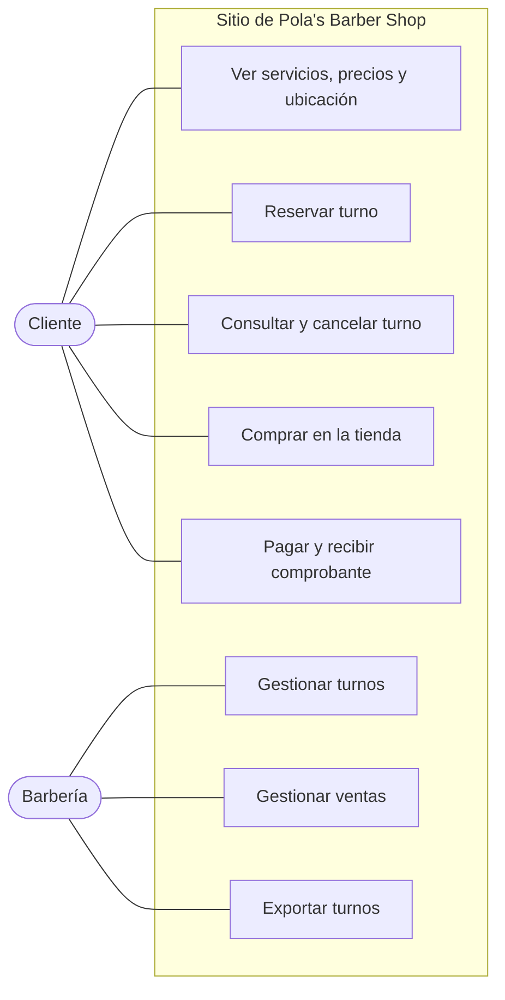
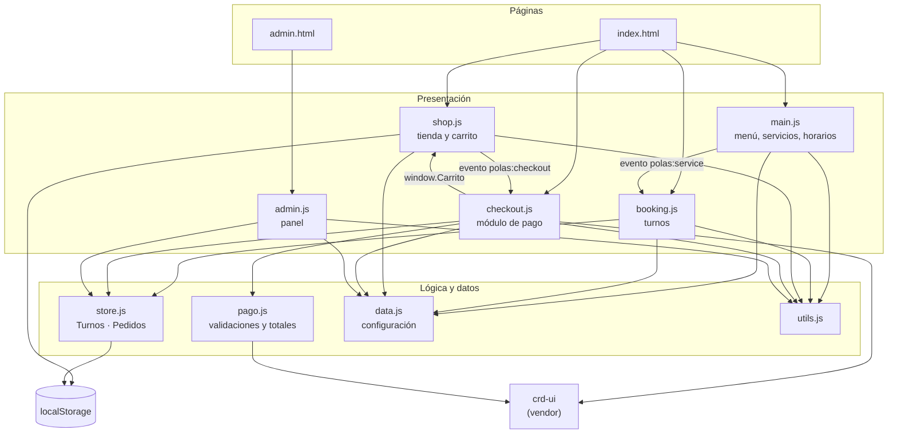
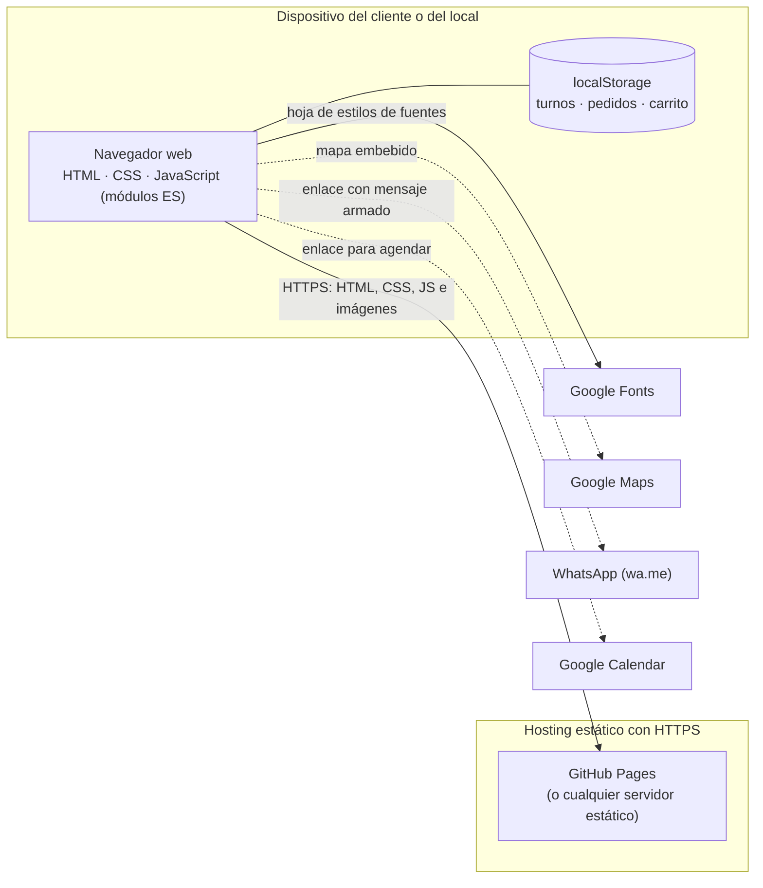
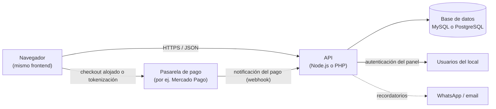
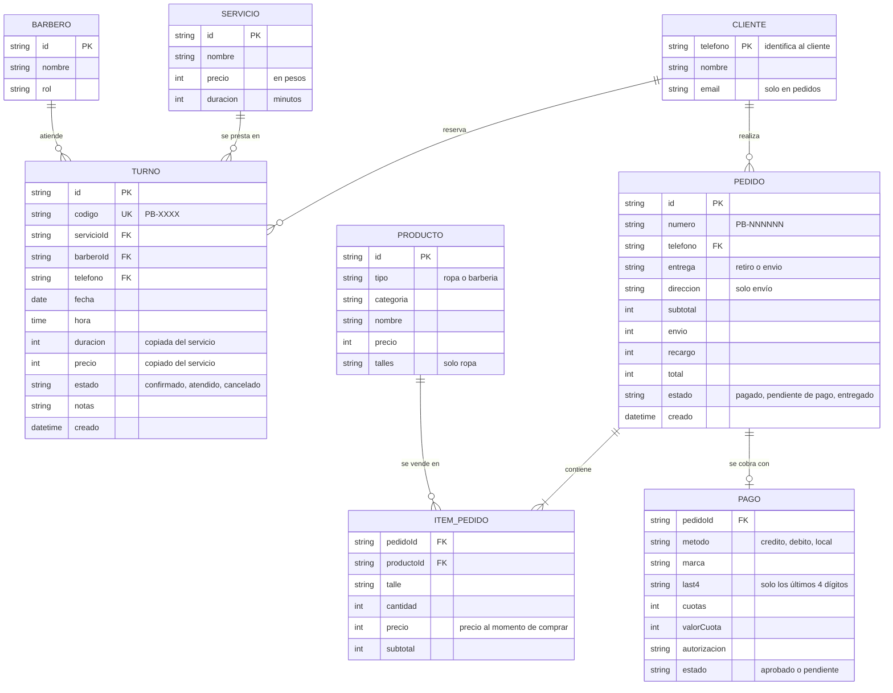
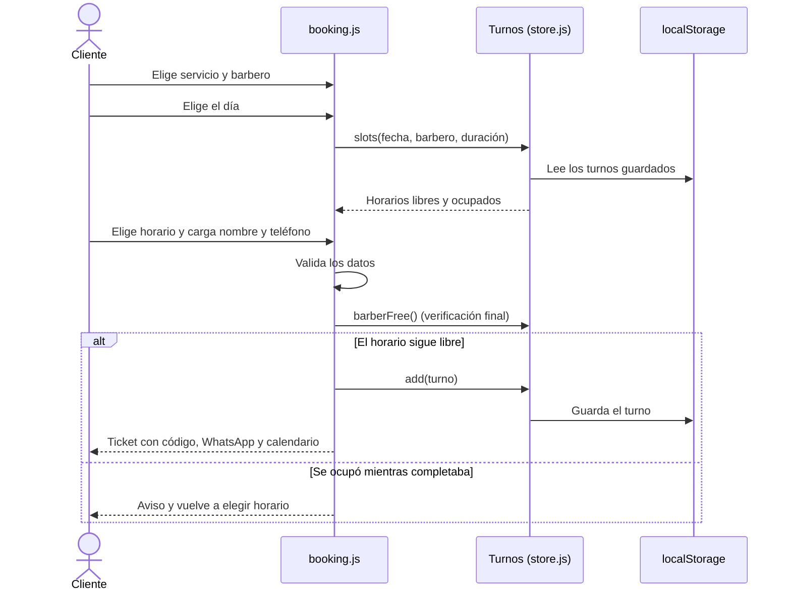
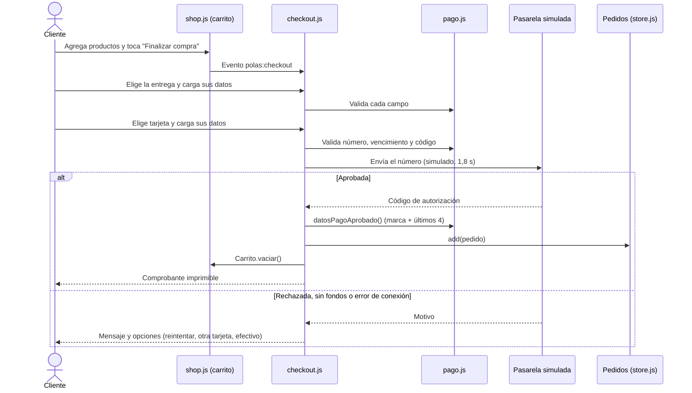
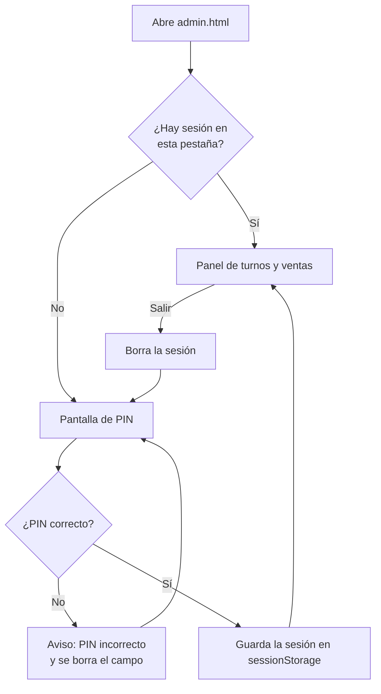
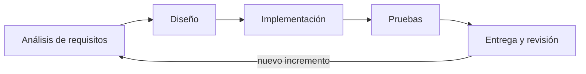
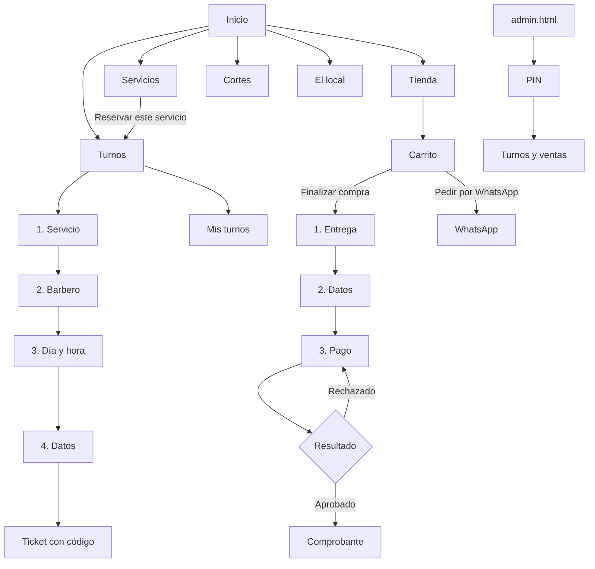

# Documentación técnica — Pola's Barber Shop

Secciones 1 a 9: introducción, descripción del sistema, arquitectura, datos, comportamiento, restricciones, pruebas, despliegue y ciclo de vida.
Proyecto individual de **Leandro Pereyra**. La identidad de la empresa, la problemática y la resolución están en [PROYECTO.md](PROYECTO.md); las tareas, en los [issues del repositorio](https://github.com/LeandroPereyra-arg/PolaBarberShop/issues?q=is%3Aissue).

> Los diagramas están escritos en Mermaid: GitHub los muestra como gráficos al abrir este archivo.
> Cuando un punto describe algo que **todavía no está implementado**, se indica como *propuesto*.

---

## 1. Introducción

### 1.1 Descripción general

**Pola's Barber Shop** es una barbería de barrio con casi diez años de trayectoria. En septiembre de 2026 se mudó a Gral. Madariaga 186, Barrio Lindo, Malvinas Argentinas (Almirante Brown). Trabaja con un equipo de cuatro personas, según las fotos del local *(a validar)*, vende ropa con su marca y productos de barbería, y hasta ahora se comunica con sus clientes solo por Instagram y WhatsApp.

Este proyecto es el **sitio web de la barbería**. Reúne en un solo lugar:

- la presentación del local: servicios con precios, galería de cortes, historia de la mudanza, horarios y mapa;
- un **sistema de turnos online**;
- una **tienda** de ropa y productos, con carrito y **módulo de pago**;
- un **panel** para que el local gestione turnos y ventas.

Es un sitio estático hecho con HTML, CSS y JavaScript, sin frameworks, que se ejecuta completo en el navegador. Código fuente: [github.com/LeandroPereyra-arg/PolaBarberShop](https://github.com/LeandroPereyra-arg/PolaBarberShop).

### 1.2 Propósito

El sistema existe para resolver tres problemas concretos de la barbería, descritos en detalle en [PROYECTO.md](PROYECTO.md#3-problemática):

1. **Los turnos se coordinan a mano** por mensajes, lo que interrumpe el trabajo, genera esperas y riesgo de superponer horarios.
2. **Toda su presencia online depende de Instagram**: no aparecen en buscadores y la información básica (precios, horarios) no está publicada.
3. **La ropa y los productos no tienen vidriera**: el cliente se entera de lo que venden solo si va al local.

El propósito es que **el cliente pueda reservar y comprar solo, a cualquier hora, y que el local tenga ordenada la información de su día**.

Como trabajo práctico, el proyecto además recorre el ciclo completo de un sistema web: análisis, diseño, desarrollo, pruebas, documentación y gestión de tareas.

### 1.3 Alcance

**Incluido en esta versión:**

| Módulo | Qué abarca |
|--------|------------|
| Sitio institucional | Servicios con precio y duración, galería, historia del nuevo local, horarios, mapa, WhatsApp e Instagram |
| Turnos | Reserva en cuatro pasos con disponibilidad por barbero, confirmación con código, consulta y cancelación con el teléfono |
| Tienda | Catálogo con filtros y talles, carrito que se conserva al recargar |
| Módulo de pago | Entrega (retiro o envío), datos del comprador, pago con crédito en cuotas, débito o efectivo/transferencia, y comprobante. **El cobro con tarjeta es simulado** |
| Panel de administración | Turnos y ventas con sus estados, estadísticas del día, exportación de turnos a CSV |
| Calidad | 57 pruebas automáticas y esta documentación |

**Fuera del alcance de esta versión:**

- Cobro real con tarjeta.
- Servidor y base de datos compartida: los datos se guardan en cada navegador (ver 6.5).
- Cuentas y contraseñas para los clientes.
- Facturación electrónica.
- Control de stock.
- Recordatorios automáticos por WhatsApp o email.
- Publicación del sitio en internet (propuesta en 8.3).

### 1.4 Objetivos de la documentación

- Describir **qué hace el sistema y cómo está construido**, para evaluarlo y defenderlo.
- Servir de **referencia para quien lo mantenga o lo amplíe**, por ejemplo para conectar una base de datos.
- Dejar registro de **las decisiones de diseño y sus motivos** (sección 9.2).
- **Separar lo implementado y verificado de lo propuesto o pendiente**, para que nadie dé por hecho algo que no existe.

| Lector | Qué le sirve |
|--------|--------------|
| Docentes de la cátedra | Todo el documento, para evaluar las consignas |
| Dueño de la barbería | Secciones 1, 2 y 8.3: qué hace el sistema y qué falta para publicarlo |
| Desarrollador que continúe el proyecto | Secciones 3, 4, 7 y 8: arquitectura, datos, pruebas y mantenimiento |

Documentos relacionados: el [README](../README.md) (cómo ejecutarlo), [PROYECTO.md](PROYECTO.md) (identidad, problemática y resolución) y los [issues](https://github.com/LeandroPereyra-arg/PolaBarberShop/issues?q=is%3Aissue) (tareas).

**Términos usados:**

| Término | Significado |
|---------|-------------|
| Turno | Reserva de un servicio con un barbero, en una fecha y hora |
| Bloque | Cada intervalo de 30 minutos en que se divide la agenda |
| Checkout o módulo de pago | El proceso desde "Finalizar compra" hasta el comprobante |
| Pasarela de pago | Servicio que autoriza un cobro con el banco. En este sistema es simulada |
| Algoritmo de Luhn | Cálculo que detecta números de tarjeta mal escritos |
| `localStorage` | Espacio del navegador donde el sistema guarda turnos, pedidos y carrito |
| crd-ui | Librería que dibuja la tarjeta en pantalla |
| Issue | Tarea registrada en el repositorio de GitHub |

---

## 2. Descripción del sistema

### 2.1 Objetivo del sistema

**Objetivo general:** brindar a Pola's Barber Shop un sitio web propio que permita a sus clientes **reservar turnos y comprar productos de forma autónoma**, y al local **organizar esa información**, respetando la identidad visual de la marca.

**Objetivos específicos:**

| # | Objetivo | Cómo se verifica | Estado |
|---|----------|------------------|--------|
| OE1 | Que el cliente reserve un turno sin intervención del local | Reserva completa en cuatro pasos (prueba W01) | ✔ |
| OE2 | Evitar turnos superpuestos | Ningún barbero queda con dos turnos en el mismo horario (pruebas de integración) | ✔ Dentro de un mismo navegador (ver 6.5) |
| OE3 | Publicar servicios, precios, horarios y ubicación | Visibles en la página principal | ✔ Con precios a validar (#11) |
| OE4 | Vender ropa y productos con todo el proceso de compra | Compra de punta a punta con comprobante (W06 a W17) | ✔ Con cobro simulado |
| OE5 | Darle al local una vista ordenada de turnos y ventas | Panel con estados y estadísticas (W18 y W19) | ✔ |
| OE6 | Mantener la identidad de la marca | Colores, logo, texturas y tono tomados de su Instagram ([PROYECTO.md](PROYECTO.md#2-identidad-de-la-empresa)) | ✔ |
| OE7 | Funcionar bien en celulares | Sin desbordes a 400 px (7.4) | ✔ |

### 2.2 Stakeholders

| Stakeholder | Interés | Qué espera del sistema | Participación |
|-------------|---------|------------------------|---------------|
| Dueño de la barbería | Que el negocio crezca y esté ordenado | Menos mensajes, agenda ordenada, ventas online, imagen profesional | Fuente de los requisitos a través de su Instagram. Pendiente: validar los datos del sistema (#11) |
| Barberos | Trabajar sin interrupciones | Saber qué turnos tienen y no contestar mensajes mientras atienden | Usuarios del panel |
| Clientes | Reservar y comprar sin vueltas | Reservar a cualquier hora desde el celular, ver precios, comprar | Usuarios del sitio |
| Desarrollador (Leandro Pereyra) | Entregar un sistema que funcione | — | Análisis, diseño, desarrollo, pruebas y documentación |
| Docentes de la cátedra | Evaluar el trabajo | Que cumpla las consignas de cada revisión | Definen requisitos académicos, como el módulo de pago con tarjeta |
| Servicios externos (GitHub, Google, WhatsApp) | — | — | Alojamiento del código, mapas, fuentes y mensajería |
| A futuro: pasarela de pago y organismos (ARCA, AAIP) | — | — | Cobro real y cumplimiento normativo (6.4) |

### 2.3 Funciones principales



**Para el cliente:**
- Ver los servicios con precio y duración, la galería de cortes, la historia del local, los horarios y el mapa.
- Reservar un turno: servicio → barbero (o "el primero libre") → día y horario disponible → datos → código de confirmación.
- Avisar del turno por WhatsApp y agendarlo en su calendario.
- Consultar sus turnos con el teléfono y cancelarlos.
- Ver el catálogo, filtrar entre ropa y barbería, elegir talle y armar el carrito.
- Finalizar la compra: entrega, datos, pago con crédito en cuotas, débito o efectivo/transferencia, y comprobante imprimible.
- Escribir por WhatsApp desde cualquier parte del sitio.

**Para la barbería (panel):**
- Entrar con PIN.
- Ver los turnos filtrados por fecha, barbero y estado; marcarlos como atendidos, cancelarlos o borrarlos.
- Ver estadísticas: turnos de hoy y de los próximos 7 días, facturación estimada del día, cancelaciones y ventas del día.
- Ver las ventas y marcarlas como pagadas o entregadas.
- Exportar los turnos a CSV.

**Configuración sin programar:** precios, horarios, barberos, productos, costo de envío, cuotas, PIN y WhatsApp se cambian en `js/data.js`.

### 2.4 Restricciones generales

- **Presupuesto cero:** sin servicios pagos. Por eso es un sitio estático, que se puede alojar gratis.
- **Un solo desarrollador** y los plazos de las revisiones de la cátedra.
- **Sin contacto directo con la barbería** durante el desarrollo: los datos salen de su Instagram público. Precios, horarios, nombres de barberos y productos son de ejemplo hasta validarlos (#11).
- **Sin servidor:** los datos quedan en cada navegador (ver 6.5).
- **Pago simulado:** no se pueden procesar tarjetas reales sin una pasarela certificada (ver 6.3 y 6.4).
- **Consigna de la cátedra:** incorporar un componente de tarjeta de crédito (crd-ui o react-credit-cards).
- **Uso desde el celular:** los clientes llegan desde Instagram, así que el sitio tiene que funcionar bien en pantallas chicas.
- **Normativa argentina** de datos personales y defensa del consumidor (ver 6.4).

El detalle técnico de estas restricciones está en la [sección 6](#6-restricciones-del-diseño).

---

## 3. Arquitectura del sistema

### 3.1 Estilo arquitectónico

Es un **sitio web estático con toda la lógica en el cliente** (navegador). No hay servidor de aplicación ni base de datos: el hosting solo entrega archivos, y cada navegador ejecuta el sistema y guarda sus datos en `localStorage`.

Dentro del cliente el código se organiza **en capas**:

| Capa | Responsabilidad | Archivos |
|------|-----------------|----------|
| Presentación | Estructura, estilos e interacción con la pantalla | `index.html`, `admin.html`, `css/styles.css`, `js/main.js`, `js/booking.js`, `js/shop.js`, `js/checkout.js`, `js/admin.js` |
| Lógica de negocio pura | Reglas sin acceso a la pantalla: validaciones, totales y pagos | `js/pago.js`, la parte de cálculo de `js/store.js` |
| Datos | Lectura y escritura de turnos, pedidos y carrito | `js/store.js` (`Turnos`, `Pedidos`), carrito en `js/shop.js` |
| Configuración | Datos del negocio editables sin tocar código | `js/data.js` |
| Utilidades | Formatos, fechas y avisos compartidos | `js/utils.js` |

Los módulos se comunican de dos formas:

- **Eventos del navegador** para no acoplar pantallas entre sí: `polas:service` (de la lista de servicios al sistema de turnos) y `polas:checkout` (del carrito al módulo de pago).
- **Interfaces chicas y explícitas**: `Turnos` y `Pedidos` (almacenamiento) y `window.Carrito` (el carrito expuesto al módulo de pago).

La capa de datos está aislada a propósito: para pasar a una base de datos real alcanza con reemplazar `js/store.js` manteniendo las mismas funciones (`read`, `add`, `update`, `slots`…), sin cambiar las pantallas.

### 3.2 Componentes principales

| Componente | Archivo | Qué hace |
|-----------|---------|----------|
| Configuración | `js/data.js` | Datos del local, horarios, servicios, barberos, productos, costos de envío, planes de cuotas y tarjetas de prueba |
| Utilidades | `js/utils.js` | Formato de precios y fechas, enlaces de WhatsApp, protección contra HTML (`escapeHtml`), avisos (`toast`) |
| Almacenamiento | `js/store.js` | `Turnos`: alta, cambios, búsqueda por teléfono y cálculo de horarios libres. `Pedidos`: alta y cambio de estado |
| Sitio institucional | `js/main.js` | Menú, lista de servicios, tabla de horarios, animaciones de entrada |
| Sistema de turnos | `js/booking.js` | Asistente de 4 pasos, confirmación con código, "Mis turnos" con cancelación |
| Tienda | `js/shop.js` | Catálogo con filtros y talles, carrito persistente, interfaz `window.Carrito` |
| Módulo de pago | `js/checkout.js` | Entrega, datos del comprador, pago, pasarela simulada y comprobante |
| Lógica de pago | `js/pago.js` | Validaciones, algoritmo de Luhn, totales y cuotas, datos del pago que se guardan |
| Ilustraciones | `js/art.js` | Dibujos SVG de los productos con el logo |
| Panel de administración | `admin.html`, `js/admin.js` | Acceso con PIN, turnos y ventas, estadísticas del día, exportación a CSV |
| Tarjeta visual | `vendor/crd-ui/` | Librería **crd-ui 0.13.2** (MIT): dibujo de la tarjeta y detección de la marca |



### 3.3 Diagrama de despliegue

**Situación actual.** El sistema se publica como archivos estáticos. Todo se ejecuta en el navegador; los servicios externos solo reciben enlaces o se muestran embebidos.



**Arquitectura propuesta para producción.** Para que los turnos y las ventas se compartan entre clientes y local, y para cobrar de verdad, se suma un backend.



En ese esquema los datos de la tarjeta van directo del navegador a la pasarela y **nunca pasan por el servidor del local**.

### 3.4 Escalabilidad y rendimiento

**Rendimiento medido** (archivos del repositorio, 26/11/2026):

| Recurso | Tamaño | Comprimido (gzip) |
|---------|--------|-------------------|
| `index.html` | 25,3 KB | 6,6 KB |
| CSS propio | 49,1 KB | 10,4 KB |
| JavaScript propio (10 archivos, 1.700 líneas) | 67,1 KB | 20,6 KB |
| crd-ui (JS + CSS) | 38,3 KB | 10,5 KB |
| Logo | 66,3 KB | — |
| Fotos (9 JPG) | 359,9 KB | — |
| **Total del sitio** | **617,9 KB** | |

- La primera carga de la página principal, sin contar las fotos, es de unos **254 KB**. Las fotos se cargan recién cuando se acercan a la pantalla (`loading="lazy"`).
- **Optimización aplicada:** el logo original pesaba **648 KB**, más de la mitad del sitio. Se redujo a 600 px de ancho (suficiente para pantallas de alta densidad) y a una paleta de 128 colores: quedó en **66 KB** (−90 %) sin pérdida visible. El total bajó de 1,2 MB a 618 KB.
- **Sin frameworks ni dependencias de compilación**: el navegador ejecuta los archivos tal cual.
- Las fuentes usan `display=swap`: el texto se ve con la fuente del sistema mientras carga la definitiva.
- Las animaciones se desactivan si el usuario lo pide en su sistema (`prefers-reduced-motion`).
- El cálculo de horarios libres recorre los turnos guardados por cada bloque del día: con el volumen de una barbería (decenas de turnos por día) es instantáneo.

**Escalabilidad.** El hosting estático soporta cualquier cantidad de visitas sin cambios. El límite real es el almacenamiento:

- `localStorage` guarda los datos **solo en ese navegador** (unos 5 MB). No escala a varios usuarios: el local no ve las reservas que hace un cliente desde su celular.
- El crecimiento previsto es el de la sección 3.3: una API con base de datos, reemplazando `js/store.js`. El frontend ya está preparado para ese cambio.

---

## 4. Diseño de datos

### 4.1 Diagrama entidad-relación

Modelo **lógico** del sistema. Hoy se guarda como documentos JSON en el navegador (ver 4.2); el mismo modelo sirve para crear las tablas de la base de datos propuesta.



### 4.2 Descripción de entidades

**Datos de configuración** (en `js/data.js`, editados por el local):

| Entidad | Contenido | Ejemplo |
|---------|-----------|---------|
| Servicio | Id, nombre, descripción, precio, duración y etiqueta opcional | Corte + Barba, $12.000, 60 min |
| Barbero | Id, nombre y especialidad. El valor `cualquiera` no es un barbero: significa "el primero libre" y el sistema asigna uno real | Pola, fades y diseños |
| Producto | Id, tipo (`ropa` o `barberia`), categoría, nombre, descripción, precio, talles (ropa), dibujo y color | Remera Pola's Classic, $18.000, S a XXL |
| Configuración | Horarios por día, bloque de turnos (30 min), días reservables (14), envío ($3.500, gratis desde $60.000), cuotas y recargos, PIN del panel | — |

**Datos que genera el sistema** (en `localStorage`):

| Clave | Entidad | Campos |
|-------|---------|--------|
| `polas_turnos_v1` | Lista de **turnos** | `id`, `codigo`, `estado`, `creado`, `servicioId`, `servicio`, `precio`, `duracion`, `barberoId`, `barbero`, `fecha`, `hora`, `nombre`, `telefono`, `notas` |
| `polas_pedidos_v1` | Lista de **pedidos** | `id`, `numero`, `creado`, `items[]`, `subtotal`, `envio`, `recargo`, `total`, `cuotas`, `valorCuota`, `entrega`, `cliente{nombre, telefono, email, direccion, localidad, cp}`, `pago{metodo, marca, marcaNombre, last4, cuotas, valorCuota, autorizacion, estado}`, `estado` |
| `polas_carrito_v1` | **Carrito** en curso | Lista de `{id, talle, qty}` |
| `polas_admin` (sesión) | Marca de **sesión del panel** | `"1"` mientras la pestaña está abierta |

Decisiones de diseño:

- **El cliente no tiene cuenta.** Se identifica por su teléfono, que es como la barbería ya se comunica con sus clientes. En el modelo lógico es una entidad; hoy sus datos van copiados dentro de cada turno y pedido.
- **Se copian nombre y precio del servicio o producto** en el turno y el pedido. Así, si el local cambia un precio, los turnos y ventas anteriores conservan el valor que se cobró.
- **El pago se guarda dentro del pedido** y nunca incluye el número completo, el vencimiento ni el código de seguridad.

### 4.3 Reglas de integridad

Reglas que el sistema hace cumplir en el código:

| Regla | Dónde se controla |
|-------|-------------------|
| Un barbero no puede tener dos turnos superpuestos: se compara el rango completo (inicio + duración) | `Turnos.barberFree` en `store.js` |
| Un turno debe empezar y terminar dentro del horario del día; los días cerrados no ofrecen horarios | `Turnos.slots` |
| No se ofrecen horarios pasados ni los que empiezan en menos de 15 minutos | `Turnos.slots` |
| Solo se reserva dentro de los próximos 14 días | `booking.js` (`CONFIG.diasReserva`) |
| Antes de confirmar se vuelve a verificar que el horario siga libre | `confirmar()` en `booking.js` |
| "El primero libre" siempre se convierte en un barbero real antes de guardar | `Turnos.slots` y `booking.js` |
| Los turnos cancelados no ocupan lugar | `Turnos.slots` (filtra por estado) |
| Solo se pueden cancelar turnos confirmados y futuros | "Mis turnos" en `booking.js` |
| Los estados tienen valores cerrados: turno (`confirmado`, `atendido`, `cancelado`) y pedido (`pagado`, `pendiente de pago`, `entregado`) | `booking.js`, `checkout.js`, `admin.js` |
| Un producto de ropa no se agrega al carrito sin talle | `shop.js` |
| El total se recalcula siempre a partir del catálogo y la configuración; nunca se toma un valor escrito por el usuario | `calcularTotales` en `pago.js` |
| Un pedido con tarjeta solo se guarda si el pago fue aprobado | `confirmar()` en `checkout.js` |
| **Nunca se guardan el número completo de la tarjeta, el vencimiento ni el código** | `datosPagoAprobado` en `pago.js` (verificado por pruebas) |

Limitaciones conocidas:

- El `codigo` del turno (4 caracteres al azar) y el `numero` del pedido (últimos 6 dígitos de la hora) **no verifican que no se repitan**. La clave real de cada registro es `id`, que sí es única. En la base de datos propuesta se usarían claves autoincrementales y restricciones `UNIQUE`.
- Al no haber servidor, dos dispositivos podrían reservar el mismo horario: cada uno solo ve sus propios datos (ver 6.5).

### 4.4 Migración y respaldo

**Versionado.** Las claves de `localStorage` llevan versión (`_v1`). Si cambia la estructura de los datos, se usa una clave nueva (`_v2`) y se convierte la anterior al cargar, sin perder información.

**Respaldo actual.**
- El panel exporta los turnos a **CSV** (con BOM para que Excel muestre bien los acentos).
- Los pedidos todavía **no** tienen exportación: es una mejora pendiente.
- Como los datos viven en un navegador, borrar los datos del sitio o cambiar de equipo los pierde. Por eso el respaldo frecuente (CSV) es importante mientras no haya base de datos.

**Migración propuesta a base de datos.**
1. Crear las tablas del diagrama 4.1 con claves primarias, foráneas y restricciones `UNIQUE` (código de turno, número de pedido).
2. Cargar servicios, barberos y productos desde `js/data.js`.
3. Importar turnos y pedidos desde el JSON de `localStorage` o desde el CSV exportado, separando los datos del cliente en su propia tabla.
4. Reemplazar `js/store.js` por llamadas a la API con las mismas funciones.
5. Respaldo automático diario de la base, guardando al menos 30 días, y una prueba periódica de restauración.

---

## 5. Comportamiento del sistema

### 5.1 Escenarios principales

| # | Escenario | Actor | Resultado |
|---|-----------|-------|-----------|
| E1 | Reservar un turno | Cliente | Turno confirmado con código, aviso por WhatsApp y alta en el calendario |
| E2 | Consultar y cancelar un turno | Cliente | Turno cancelado y horario liberado |
| E3 | Comprar con tarjeta (aprobada) | Cliente | Pedido pagado, comprobante, carrito vacío |
| E4 | Pago con tarjeta rechazado | Cliente | Mensaje con el motivo y opciones: reintentar, usar otra tarjeta o pagar en efectivo |
| E5 | Comprar con efectivo o transferencia | Cliente | Pedido registrado como pendiente de pago |
| E6 | Gestionar turnos y ventas | Barbería | Turnos marcados como atendidos o cancelados, ventas como pagadas o entregadas, exportación a CSV |

**E1 — Reserva de turno**



**E3 y E4 — Compra con tarjeta**



### 5.2 Inicio de sesión

**Clientes:** no inician sesión. Para consultar o cancelar un turno escriben su teléfono en "Mis turnos" (mínimo 6 dígitos; se comparan los últimos 8, así no importa si lo escriben con +54, guiones o espacios).

**Personal de la barbería:** entra al panel (`admin.html`) con un PIN.



La sesión dura lo que dura la pestaña (`sessionStorage`): al cerrarla hay que volver a ingresar el PIN.

**Limitación importante:** el PIN se compara en el navegador y figura en `js/data.js`, así que es **solo de demostración**: quien lea el código puede verlo. En producción el inicio de sesión tiene que validarse en el servidor, con usuario y contraseña guardada con hash (ver 6.3).

### 5.3 Validaciones

**Reserva de turnos** (`booking.js`):

| Dato | Regla | Mensaje |
|------|-------|---------|
| Servicio, barbero, día y horario | Obligatorios; el botón "Siguiente" queda deshabilitado hasta elegirlos | — |
| Día | Dentro de los próximos 14 días; los días cerrados aparecen deshabilitados | — |
| Horario | Libre, futuro y que el servicio termine antes del cierre; los ocupados aparecen tachados | — |
| Nombre | Al menos 2 caracteres | Poné tu nombre |
| Teléfono | Al menos 8 dígitos | Ingresá un teléfono válido |
| Búsqueda en "Mis turnos" | Al menos 6 dígitos | Ingresá tu número (mínimo 6 dígitos). |

**Tienda:** un producto de ropa necesita talle; si falta, se sacuden los talles y aparece "Elegí un talle primero".

**Módulo de pago** (reglas en `js/pago.js`, cubiertas por pruebas unitarias):

| Dato | Regla | Mensaje |
|------|-------|---------|
| Entrega | Obligatoria | Elegí cómo querés recibir tu pedido |
| Nombre | Al menos 3 caracteres | Ingresá tu nombre y apellido |
| Teléfono | Al menos 8 dígitos | Ingresá un teléfono válido (mínimo 8 números) |
| Email | Formato `nombre@dominio.ext` | Ingresá un email válido, por ejemplo nombre@mail.com |
| Dirección (solo envío) | Calle y número (debe incluir un número) | Ingresá calle y número |
| Localidad (solo envío) | Al menos 3 caracteres | Ingresá la localidad |
| Código postal (solo envío) | 4 números o CPA (`B1851ABC`) | Código postal de 4 números (o CPA, ej. B1851ABC) |
| Medio de pago | Obligatorio | Elegí un medio de pago |
| Número de tarjeta | Marca reconocida | No reconocemos esa tarjeta |
| | Largo válido para esa marca | Una Visa tiene 13 o 16 o 19 números (según la marca) |
| | Dígito verificador correcto (algoritmo de Luhn) | El número no es válido, revisalo |
| | American Express no se acepta como débito | American Express no tiene tarjetas de débito |
| Titular | Nombre y apellido, solo letras | Escribí nombre y apellido como figuran en la tarjeta |
| Vencimiento | Formato MM/AA | Usá el formato MM/AA |
| | Mes entre 01 y 12 | El mes tiene que ser entre 01 y 12 |
| | No vencida (vale hasta el último día del mes) | La tarjeta está vencida |
| | No más de 15 años hacia adelante | Revisá el año de vencimiento |
| Código de seguridad | 3 dígitos, o 4 en American Express | El código de seguridad tiene N números |

Cómo se muestran:
- Se valida **al salir de cada campo** y, si ya tenía un error, **mientras se corrige**.
- Al intentar avanzar se marcan todos los campos con problemas y el cursor va al primero.
- Los campos de la tarjeta **se formatean solos**: el número se agrupa según la marca, el vencimiento agrega la barra y el código solo acepta dígitos, con el largo de la marca.

### 5.4 Manejo de errores

| Situación | Cómo responde el sistema |
|-----------|--------------------------|
| El horario elegido se ocupó mientras el cliente completaba sus datos | Aviso "Ese horario se acaba de ocupar. Elegí otro." y vuelve al paso de horarios |
| No quedan horarios en el día elegido | Mensaje sugiriendo otro día u otro barbero |
| Pago **rechazado** por el banco | Pantalla con el motivo, aclaración de que no se cobró nada, y opciones: otra tarjeta o efectivo/transferencia |
| **Saldo insuficiente** | Igual que el rechazo, con su mensaje propio |
| **Error de conexión** con el banco | Mensaje con botón **Reintentar el pago**, además de las otras opciones |
| Intentar cerrar la ventana mientras se procesa el pago | Se bloquea con el aviso "Esperá a que termine el pago" |
| Intentar pagar dos veces (doble clic) | Se ignora: hay un indicador de pago en curso |
| El navegador bloquea `localStorage` (por ejemplo, modo privado estricto) | Todos los accesos están protegidos: el sitio sigue funcionando, solo que no recuerda los datos (verificado por prueba de integración) |
| Datos guardados dañados o con formato inválido | Se toman como lista vacía en lugar de romper la página |
| Avanzar sin completar un paso | No avanza; marca los campos o muestra un aviso |
| PIN incorrecto en el panel | Aviso "PIN incorrecto" y se borra el campo |
| Texto con HTML escrito por un usuario (por ejemplo en notas) | Se muestra como texto, nunca se interpreta (`escapeHtml`) |

---

## 6. Restricciones del diseño

### 6.1 Compatibilidad

- **Navegadores:** versiones actuales de Chrome, Edge, Firefox y Safari. Las características más nuevas que usa el sitio son las unidades `svh`, `aspect-ratio` y los módulos de JavaScript, disponibles desde **Chrome/Edge 108, Firefox 101 y Safari 15.4** (2022). En navegadores más viejos el sitio puede verse desordenado o el módulo de pago no cargar.
- **Probado en:** navegador basado en Chromium, a 1280 px (escritorio) y 400 px (celular). Falta probar en Safari de iPhone y en Firefox (ver 7.4).
- **Dispositivos:** diseño adaptable a celulares, probado a 400 px de ancho. En celular el módulo de pago ocupa toda la pantalla y la tarjeta se ajusta al ancho.
- **Se tiene que abrir desde un servidor** (`http://` o `https://`). Si se abre el archivo con doble clic (`file://`), el navegador no carga los módulos de JavaScript y el módulo de pago no funciona.
- **JavaScript obligatorio:** sin JavaScript se ve el contenido institucional, pero no funcionan turnos, tienda ni pago.
- **Idioma y moneda:** castellano rioplatense, pesos argentinos con formato `es-AR` ($18.000).

### 6.2 Rendimiento

Objetivos y estado:

| Objetivo | Estado |
|----------|--------|
| Primera carga liviana para datos móviles | ✔ 254 KB sin fotos; 618 KB el sitio completo |
| Imágenes que no bloqueen la carga | ✔ Fotos con carga diferida; logo optimizado de 648 KB a 66 KB |
| Respuesta inmediata al interactuar | ✔ Todo se calcula en el navegador, sin esperas de red (salvo la demora simulada del pago, 1,8 s, para imitar a un banco) |
| Sin dependencias pesadas | ✔ Una sola librería externa (crd-ui, 10,5 KB comprimida) |
| Animaciones fluidas | ✔ Solo se animan `transform` y `opacity`; se respetan las preferencias de movimiento reducido |

Pendientes: servir las fotos en formato WebP y en varios tamaños (`srcset`), y medir con Lighthouse una vez publicado.

### 6.3 Seguridad

**Lo que ya está implementado:**

- **Datos de tarjeta:** el pago es una simulación. Los datos de la tarjeta **no se guardan, no se envían y no viajan en el mensaje de WhatsApp**; el pedido guarda solo la marca y los últimos 4 dígitos. Al aprobarse el pago, los campos de la tarjeta se borran de la pantalla. Hay pruebas automáticas que lo verifican.
- **Aviso explícito** en el formulario: "No ingreses los datos de una tarjeta real", con tarjetas de prueba disponibles.
- **Sin autocompletado** en los campos de tarjeta (`autocomplete="off"`), para que el navegador no ofrezca tarjetas reales guardadas.
- **Protección contra inyección de HTML (XSS):** todo dato escrito por un usuario se escapa con `escapeHtml` antes de mostrarse.
- **Enlaces externos** con `rel="noopener"`, para que la página abierta no controle la del sitio.
- **Librería externa revisada:** crd-ui se incorporó copiada en el repositorio (versión fija, sin descargas en tiempo de ejecución). Antes de usarla se verificó que no hace llamadas de red, no usa almacenamiento y no ejecuta código dinámico.

**Riesgos conocidos y cómo se resolverían en producción:**

| Riesgo actual | Solución propuesta |
|---------------|--------------------|
| El PIN del panel está en el código y se valida en el navegador | Inicio de sesión en el servidor, con contraseña guardada con hash y bloqueo tras varios intentos fallidos |
| Los datos personales (nombre, teléfono, email, dirección) quedan en `localStorage`, legibles por cualquiera que use ese dispositivo | Guardarlos en la base de datos del servidor y no en el navegador |
| No hay cobro real | Integrar una pasarela certificada con checkout alojado o tokenización, para que la tarjeta nunca pase por el sistema del local |
| Sin cabeceras de seguridad | Publicar con HTTPS y configurar una política de seguridad de contenido (CSP) |

### 6.4 Normativas aplicables

| Norma | Qué exige | Estado en el proyecto |
|-------|-----------|-----------------------|
| **Ley 25.326** de Protección de los Datos Personales | Informar para qué se usan los datos y pedir consentimiento, protegerlos, y permitir acceder a ellos, corregirlos y suprimirlos. Las bases de datos se registran ante la Agencia de Acceso a la Información Pública (AAIP) | **Pendiente:** falta una política de privacidad y el aviso de consentimiento en los formularios. Hoy los datos quedan solo en el dispositivo del usuario |
| **Ley 24.240** de Defensa del Consumidor | Precios finales claros. En ventas a distancia, derecho a arrepentirse dentro de los 10 días (art. 34) | ✔ Precios finales en pesos con el total visible antes de pagar. **Pendiente:** informar el derecho de arrepentimiento |
| **Resolución 424/2020** de la Secretaría de Comercio Interior | Quien vende por internet debe tener un "botón de arrepentimiento" visible en la página de inicio | **Pendiente:** obligatorio si la tienda vende online de verdad |
| **PCI DSS** (estándar internacional de la industria de tarjetas) | Protección de los datos de tarjeta en todo sistema que los procese | ✔ No aplica a la simulación porque no procesa ni guarda tarjetas. En producción se cumple delegando el cobro en una pasarela certificada |
| Facturación electrónica (**ARCA**, ex AFIP) | Emitir factura por cada venta | El comprobante del sitio **no es una factura**. En producción la factura la emite el sistema de facturación del local |
| **Ley 11.723** de Propiedad Intelectual y licencias | Permiso para usar marcas e imágenes ajenas; respetar las licencias del software | **Pendiente:** el logo y las fotos son de la barbería y hay que pedirle autorización. crd-ui se usa respetando su licencia MIT (aviso incluido en `vendor/crd-ui/LICENSE`) |
| **Ley 26.653** de Accesibilidad web | Obligatoria para el Estado y sus prestadores; toma las pautas internacionales WCAG | No es obligatoria para un comercio privado, pero se siguen buenas prácticas: textos alternativos, foco visible, navegación con teclado en el pago, mensajes anunciados a lectores de pantalla y contraste |

### 6.5 Limitaciones tecnológicas

- **Sin servidor ni base de datos.** Los datos viven en cada navegador: el local no ve las reservas que hace un cliente desde su teléfono y dos personas pueden reservar el mismo horario en dispositivos distintos. Es la limitación principal (issue #12).
- **`localStorage`:** unos 5 MB por sitio, se pierde si se borran los datos del navegador y no se sincroniza entre dispositivos.
- **Pagos simulados:** la pasarela es una imitación; no hay cobro real.
- **Sin notificaciones automáticas:** WhatsApp y el calendario se usan con enlaces que el usuario confirma; no hay recordatorios automáticos.
- **Sin control de stock:** se puede comprar cualquier cantidad de un producto.
- **Seguridad del panel de demostración** (ver 5.2 y 6.3).
- **Logos de marcas genéricos:** crd-ui trae marcas genéricas para no usar logos con derechos registrados; se pueden reemplazar con los oficiales si se obtiene la licencia.
- **Requiere servidor HTTP** incluso para probarlo en una computadora (ver 6.1).

---

## 7. Pruebas y validaciones

Las pruebas automáticas usan el corredor de pruebas que trae **Node.js** (`node:test`), sin instalar nada. Se ejecutan con:

```bash
npm test
```

**Resultado de la última ejecución (26/11/2026): 57 pruebas, 57 aprobadas, 0 fallidas** (44 unitarias y 13 de integración).

Para poder probar la lógica sin navegador:
- Las reglas del pago se separaron en `js/pago.js`, un módulo sin acceso a la pantalla.
- Los scripts del sitio (`data.js`, `utils.js`, `store.js`) se cargan en un entorno aislado de Node con un `localStorage` simulado (`tests/helpers/sitio.mjs`).

### 7.1 Pruebas unitarias

Prueban cada función por separado (`tests/unit/`).

| Archivo | Qué prueba | Casos |
|---------|-----------|-------|
| `pago.test.mjs` | Algoritmo de Luhn (válido, dígito cambiado, vacío). Número de tarjeta (vacío, marca desconocida, largo, Luhn, Amex como débito). Vencimiento (futuro, mes en curso, vencida, mes inexistente, formato, año lejano). Código de seguridad (3 o 4 dígitos según la marca). Titular, email, teléfono, código postal y dirección. Totales (retiro, envío con y sin costo, 3 cuotas sin interés, 6 cuotas con 10 %, redondeo de la cuota, débito sin cuotas, plan inexistente). Pasarela simulada. Datos del pago guardados sin el número completo | 34 |
| `turnos.test.mjs` | Domingo cerrado; bloques del lunes de 10:00 a 19:30; horario extendido del sábado; un servicio de 60 min no termina después del cierre; "el primero libre" asigna un barbero real; conversión entre hora y minutos | 6 |
| `utils.test.mjs` | Formato de precios, limpieza de teléfonos, escape de HTML, fechas en castellano | 4 |

### 7.2 Pruebas de integración

Prueban varias partes trabajando juntas (`tests/integration/`).

| Archivo | Qué integra | Casos |
|---------|-------------|-------|
| `reservas.test.mjs` | Sistema de turnos + almacenamiento. Reservar bloquea al barbero durante toda la duración; no se aceptan superposiciones; los demás barberos siguen libres; el turno queda guardado; se encuentra por teléfono escrito de otra forma; cancelar libera el horario; con el almacenamiento bloqueado el sistema no se rompe | 7 |
| `pedidos.test.mjs` | Configuración + crd-ui + lógica de pago + guardado de pedidos. Las tarjetas de prueba pasan la validación; crd-ui reconoce la marca de cada una; la pasarela devuelve el resultado anunciado; el catálogo tiene precios y talles válidos; una compra completa en 6 cuotas da $44.550 y se guarda **sin el número completo ni el código**; el panel puede cambiar el estado del pedido | 6 |

### 7.3 Pruebas de funcionalidades web

Pruebas de punta a punta ejecutadas en el navegador sobre el sitio servido localmente.

| ID | Prueba | Resultado esperado | Resultado |
|----|--------|--------------------|-----------|
| W01 | Reservar un turno completo (servicio, barbero, día, horario y datos) | Ticket con código; el horario queda ocupado | ✔ |
| W02 | Avanzar sin nombre ni teléfono | No avanza y marca los dos campos | ✔ |
| W03 | Buscar el turno en "Mis turnos" y cancelarlo | Aparece el turno; al cancelar pasa a "cancelado" | ✔ |
| W04 | Agregar ropa sin elegir talle | No se agrega; aviso "Elegí un talle primero" | ✔ |
| W05 | Filtrar la tienda por "Barbería" | Muestra solo los 6 productos de barbería | ✔ |
| W06 | Abrir el pago y avanzar sin elegir entrega | Se queda en el paso 1 | ✔ |
| W07 | Elegir envío | Suma $3.500 y pide dirección, localidad y código postal | ✔ |
| W08 | Datos con email y código postal inválidos | Muestra los dos mensajes correspondientes | ✔ |
| W09 | Tarjeta con número inválido, titular sin apellido, vencida y código corto | Cuatro mensajes de error, uno por campo | ✔ |
| W10 | Pagar con la tarjeta "rechazada" | Pantalla "Pago rechazado"; no se guarda el pedido; el carrito sigue igual | ✔ |
| W11 | Intentar cerrar mientras se procesa | La ventana no se cierra | ✔ |
| W12 | Pagar en 6 cuotas con tarjeta aprobada | Total $44.550 (6 × $7.425); comprobante; carrito vacío; campos de tarjeta borrados | ✔ |
| W13 | Revisar el pedido guardado | Solo marca y últimos 4 dígitos; sin número completo, vencimiento ni código | ✔ |
| W14 | Elegir débito | Se oculta el selector de cuotas | ✔ |
| W15 | Usar American Express como débito | "American Express no tiene tarjetas de débito"; el código pasa a 4 dígitos | ✔ |
| W16 | Tarjeta con "error de conexión" y reintentar | Botón "Reintentar el pago"; se puede volver a intentar | ✔ |
| W17 | Pasar a efectivo tras un error | Pedido registrado como "pendiente de pago" | ✔ |
| W18 | Ver las ventas en el panel y marcar un pedido como pagado | Aparecen los pedidos; el total del día se actualiza | ✔ |
| W19 | PIN del panel y carga de turnos de ejemplo | Acceso con el PIN; estadísticas del día actualizadas | ✔ |
| W20 | Imprimir el comprobante | Se imprime solo el comprobante | Pendiente de prueba manual |
| W21 | Exportar turnos a CSV y abrirlo en Excel | Archivo con acentos correctos | Pendiente de prueba manual |

### 7.4 Pruebas del frontend

| Prueba | Resultado |
|--------|-----------|
| Escritorio a 1280 px: módulo de pago con tarjeta, formulario y resumen a la vista | ✔ |
| Celular a 400 px: pago en pantalla completa, tarjeta de 300 px, sin desplazamiento horizontal (verificado midiendo todos los elementos) | ✔ |
| Sitio completo a 545 px: ningún elemento más ancho que la pantalla | ✔ |
| La tarjeta refleja en vivo número, nombre y vencimiento | ✔ |
| Consola del navegador sin errores durante todas las pruebas | ✔ |
| Teclado: Escape cierra el pago | ✔ |
| Teclado: Tab no se escapa del panel de pago (vuelve al primer elemento) | ✔ |
| Mensajes de estado anunciados a lectores de pantalla (`aria-live`) y errores marcados con `aria-invalid` | ✔ Implementado; no probado con un lector de pantalla real |
| Safari en iPhone y Firefox | Pendiente |

**Errores encontrados durante las pruebas y corregidos:**
1. La tarjeta no mostraba los datos: crd-ui calcula el tamaño de la letra según el ancho, y se le había pasado un porcentaje. La letra quedaba en menos de 1 px. Se cambió a un ancho fijo.
2. El campo "Código de seguridad" se desbordaba sobre el resumen. Faltaba permitir que los campos se achiquen dentro de la grilla.
3. El resumen de la compra perdía la parte superior al desplazar el formulario. Ahora el formulario se desplaza solo y el resumen queda fijo.

### 7.5 Criterios de aceptación

| Funcionalidad | Criterio (dado / cuando / entonces) | Estado |
|---------------|-------------------------------------|--------|
| Reserva | **Dado** un horario libre, **cuando** el cliente completa los 4 pasos, **entonces** recibe un código y ese horario deja de ofrecerse para ese barbero | ✔ |
| Superposición | **Dado** un turno de 60 min a las 14:00, **cuando** otro cliente busca a ese barbero, **entonces** no se ofrecen las 13:30, 14:00 ni 14:30 | ✔ |
| Cancelación | **Dado** un turno futuro, **cuando** el cliente lo cancela desde "Mis turnos", **entonces** el horario vuelve a estar libre | ✔ |
| Carrito | **Dado** un producto de ropa, **cuando** se intenta agregar sin talle, **entonces** no se agrega y se avisa | ✔ |
| Totales | **Dado** un carrito de $37.000 con envío, **cuando** se elige pagar en 6 cuotas, **entonces** el total es $44.550 en 6 cuotas de $7.425 | ✔ |
| Validación de tarjeta | **Dado** un número que no cumple Luhn o una tarjeta vencida, **cuando** se intenta pagar, **entonces** no se procesa y se indica el error en el campo | ✔ |
| Pago aprobado | **Dado** datos válidos, **cuando** la pasarela aprueba, **entonces** se guarda el pedido, se vacía el carrito y se muestra el comprobante | ✔ |
| Pago rechazado | **Dado** un rechazo, **cuando** vuelve la respuesta, **entonces** no se guarda el pedido, el carrito se conserva y se ofrecen alternativas | ✔ |
| Privacidad de la tarjeta | **Dado** cualquier pago, **cuando** se guarda el pedido, **entonces** no contiene el número completo, el vencimiento ni el código | ✔ |
| Panel | **Dado** el PIN correcto, **cuando** se ingresa al panel, **entonces** se ven turnos y ventas y se pueden cambiar sus estados | ✔ |

---

## 8. Despliegue y operación

### 8.1 Entorno de desarrollo

| Herramienta | Versión usada | Para qué |
|-------------|---------------|----------|
| Windows 10 Pro | 22H2 | Sistema operativo |
| Python | 3.14 | Servidor local (`http.server`) |
| Node.js | 24.14 (mínimo 22) | Pruebas automáticas |
| Git | 2.53 | Control de versiones |
| GitHub | — | Repositorio, issues y publicación |
| Navegador basado en Chromium | — | Pruebas de funcionamiento |

No hace falta instalar dependencias. Para trabajar:

```bash
git clone https://github.com/LeandroPereyra-arg/PolaBarberShop.git
```

```bash
python -m http.server 5510
```

Después se abre `http://localhost:5510`, y para correr las pruebas:

```bash
npm test
```

Flujo de trabajo: cada tarea se registra como issue, el commit que la termina la cierra con `Closes #N`, y antes de subir cambios se corren las pruebas.

### 8.2 Entorno de producción

**Propuesto: GitHub Pages**, un hosting estático gratuito con HTTPS que publica directo desde la rama `main`:

- **Dirección:** `https://leandropereyra-arg.github.io/PolaBarberShop/`
- **Requisitos:** ninguno más allá del repositorio. El sitio no necesita compilación, y las rutas son relativas, así que funciona dentro de la subcarpeta.
- **Alternativas equivalentes:** Netlify, Vercel o cualquier hosting que sirva archivos estáticos.

Con la arquitectura de la sección 3.3 se sumarían un servidor para la API (por ejemplo un VPS o un servicio administrado), la base de datos con respaldos y la cuenta de la pasarela de pago.

### 8.3 Publicación del sistema

**Lista de control antes de publicar** (todo en `js/data.js`):

- [ ] Poner el número real de WhatsApp (`whatsapp`).
- [ ] Cambiar el PIN de demostración (`adminPin`). Mientras no haya servidor sigue siendo visible en el código.
- [ ] Desactivar los horarios ocupados simulados (`demoOcupados: false`).
- [ ] Confirmar con la barbería precios, horarios, barberos y productos (issue #11).
- [ ] Reemplazar las ilustraciones de los productos por fotos reales (issue #13).
- [ ] Pedir autorización para usar el logo y las fotos.
- [ ] Correr `npm test` y verificar que todo pase.

**Pasos para publicar en GitHub Pages:**
1. En el repositorio, ir a **Settings → Pages**.
2. En **Source**, elegir *Deploy from a branch*, rama `main` y carpeta `/ (root)`, y guardar.
3. Esperar unos minutos y abrir la dirección indicada.
4. Probar una reserva y una compra de punta a punta en la dirección publicada.
5. Agregar el enlace en la biografía de Instagram de la barbería.

Desde ese momento, **cada `git push` a `main` actualiza el sitio** automáticamente.

### 8.4 Monitoreo

**Hoy:** el panel de administración funciona como monitoreo del negocio: turnos del día, próximos 7 días, facturación estimada, cancelaciones y ventas de la tienda. No hay monitoreo técnico automático.

**Propuesto al publicar:**

| Qué | Cómo |
|-----|------|
| Que el sitio esté en línea | Monitor gratuito de disponibilidad (por ejemplo UptimeRobot) con aviso por email si se cae |
| Publicaciones | Pestaña *Actions* de GitHub: estado de cada publicación de Pages |
| Rendimiento | Lighthouse o PageSpeed Insights después de cada cambio importante |
| Visibilidad en buscadores | Google Search Console |
| Errores en los navegadores | Con backend: registrar los errores de JavaScript (`window.onerror`) en el servidor |
| Pagos | Con pasarela real: su panel de pagos y las notificaciones de cada operación |

### 8.5 Mantenimiento

| Tarea | Cómo se hace | Frecuencia |
|-------|--------------|------------|
| Cambiar precios, horarios o servicios | Editar `js/data.js` y subir el cambio | Cuando cambien |
| Agregar un producto | Sumar una entrada en `PRODUCTOS` de `js/data.js` (con `foto` si hay imagen real) | Cuando haya stock nuevo |
| Respaldar turnos | Botón **Exportar CSV** del panel | Semanal |
| Actualizar crd-ui | Bajar la nueva versión de npm, reemplazar los archivos de `vendor/crd-ui/`, revisar los cambios y correr las pruebas | Cuando haya una versión nueva |
| Correr las pruebas | `npm test` antes de cada `git push` | En cada cambio |
| Registrar mejoras y errores | Issues del repositorio, con etiqueta y responsable | Continuo |
| Cambiar la estructura de los datos guardados | Nueva versión de clave (`_v2`) con conversión de los datos anteriores | Cuando se modifique el modelo |

**Mejoras pendientes ya identificadas:** base de datos real (#12), validar datos con la barbería (#11), publicación y fotos reales (#13), exportación de ventas, botón de arrepentimiento y política de privacidad (6.4), recordatorios automáticos de turnos y control de stock.

---

## 9. Ciclo de vida del software

El proyecto sigue un **modelo iterativo e incremental**: cada revisión de la cátedra fue un incremento que sumó funcionalidad sobre una versión que ya funcionaba. En cada incremento se repitió el ciclo de análisis, diseño, implementación, pruebas y entrega.



| Incremento | Fecha | Qué se entregó | Registro |
|------------|-------|----------------|----------|
| 1. Sitio y turnos | 14/09/2026 | Sitio con la identidad de la marca, sistema de turnos, tienda con pedido por WhatsApp y panel de turnos. Actualización por la mudanza al nuevo local | Commit `39760aa` |
| 2. Repositorio y gestión | 12/10/2026 | README; documentación de identidad, problemática y resolución; tareas como issues | Commits `6c5cfed`, `83a0fbf` y `6000d66`; issues #1 a #13 |
| 3. Módulo de pago | 26/11/2026 | Finalizar compra, pago con tarjeta (crd-ui), comprobante y ventas en el panel | Commit `d7b2c18`; issue #14 |
| 4. Calidad y documentación técnica | 26/11/2026 | Lógica de pago separada, 57 pruebas automáticas, logo optimizado y documentación de las secciones 1 a 9 | Commits `eec0a2b`, `72796e3` y `e57ee07`; issues #15 y #16 |

Los issues #1 a #10 se cargaron el 12/10 para registrar trabajo ya hecho, cuando se organizó el repositorio. Desde entonces cada tarea se abre como issue y se cierra con el commit que la termina.

### 9.1 Análisis de requisitos

**Fuentes de los requisitos:**

| Fuente | Qué aportó |
|--------|------------|
| Instagram de la barbería (biografía, publicaciones, historias destacadas) | Identidad visual, servicios, dirección, la mudanza, el tono de comunicación y que venden ropa |
| Consignas y revisiones de la cátedra | Funcionalidades obligatorias: turnos, tienda, módulo de pago con tarjeta y documentación |
| Prácticas habituales en sistemas de turnos y tiendas online | Reserva en pasos, disponibilidad en tiempo real, carrito, comprobante |
| Normativa argentina | Requisitos legales (ver 6.4) |

**Técnicas usadas:** análisis de fuentes públicas (no hubo entrevista con el dueño; queda pendiente en #11), análisis de las consignas, definición de escenarios (5.1) y criterios de aceptación (7.5), y priorización en tres niveles: **Debe**, **Debería** y **Podría**.

**Requisitos funcionales:**

| ID | Requisito | Prioridad | Estado | Verificación |
|----|-----------|-----------|--------|--------------|
| RF-01 | Mostrar los servicios con precio y duración | Debe | ✔ | Inspección |
| RF-02 | Mostrar horarios, dirección y mapa del nuevo local | Debe | ✔ | Inspección |
| RF-03 | Reservar un turno eligiendo servicio, barbero, día y horario | Debe | ✔ | W01, `reservas.test` |
| RF-04 | Ofrecer solo horarios libres y dentro del horario de atención | Debe | ✔ | `turnos.test`, `reservas.test` |
| RF-05 | Asignar automáticamente un barbero ("el primero libre") | Debería | ✔ | `turnos.test`, `reservas.test` |
| RF-06 | Confirmar el turno con código, aviso por WhatsApp y alta en el calendario | Debe | ✔ | W01 |
| RF-07 | Consultar y cancelar turnos con el teléfono | Debe | ✔ | W03, `reservas.test` |
| RF-08 | Catálogo de ropa y productos con filtros y talles | Debe | ✔ | W04, W05 |
| RF-09 | Carrito que se conserva al recargar la página | Debe | ✔ | Pruebas del módulo de pago |
| RF-10 | Elegir la forma de entrega y calcular el envío | Debe | ✔ | W07, `pago.test` |
| RF-11 | Pagar con crédito en cuotas, débito o efectivo/transferencia | Debe | ✔ | W12, W14, W17 |
| RF-12 | Mostrar la tarjeta en pantalla y validar sus datos (consigna de la cátedra) | Debe | ✔ | W09, W15, `pago.test` |
| RF-13 | Informar los pagos rechazados y ofrecer alternativas | Debe | ✔ | W10, W16 |
| RF-14 | Comprobante de compra imprimible | Debería | ✔ | W12 (impresión pendiente, W20) |
| RF-15 | Panel con acceso restringido | Debe | ✔ De demostración | W19 |
| RF-16 | Gestionar los estados de turnos y ventas | Debe | ✔ | W18, `pedidos.test` |
| RF-17 | Estadísticas del día | Debería | ✔ | W18, W19 |
| RF-18 | Exportar turnos a CSV | Podría | ✔ | W21 pendiente |
| RF-19 | Exportar ventas | Podría | Pendiente | — |
| RF-20 | Recordatorios automáticos de turnos | Podría | Pendiente | — |
| RF-21 | Control de stock | Podría | Pendiente | — |

**Requisitos no funcionales:**

| ID | Requisito | Estado | Verificación |
|----|-----------|--------|--------------|
| RNF-01 | Respetar la identidad visual de la marca | ✔ | [PROYECTO.md](PROYECTO.md#identidad-visual) |
| RNF-02 | Funcionar en celulares | ✔ | 7.4 (400 px) |
| RNF-03 | Primera carga menor a 300 KB sin contar las fotos | ✔ 254 KB | 3.4 |
| RNF-04 | No guardar nunca los datos completos de la tarjeta | ✔ | `pago.test`, `pedidos.test`, W13 |
| RNF-05 | Mostrar como texto lo que escriben los usuarios (protección contra XSS) | ✔ | `utils.test` |
| RNF-06 | Poder cambiar precios, horarios y productos sin programar | ✔ | `js/data.js` |
| RNF-07 | Sin costos de infraestructura | ✔ | 2.4, 8.2 |
| RNF-08 | Módulo de pago usable con teclado | ✔ | 7.4 |
| RNF-09 | Cumplir la normativa de datos personales y de venta online | Pendiente | 6.4 |

**Pendiente de validar con la barbería (#11):** precios, horarios de atención, nombres de los barberos, productos que venden, si hacen envíos a domicilio, costo del envío y planes de cuotas.

### 9.2 Diseño

A partir de los requisitos se diseñaron la arquitectura (sección 3), el modelo de datos (sección 4), el comportamiento (sección 5) y la interfaz.

**Decisiones de diseño:**

| # | Decisión | Alternativas consideradas | Motivo |
|---|----------|---------------------------|--------|
| D1 | Sitio estático, sin servidor | PHP con MySQL; Node.js con base de datos | Presupuesto cero y alojamiento gratuito. La capa de datos quedó aislada para sumar un servidor después |
| D2 | JavaScript sin framework | React, Vue | Sitio chico, carga rápida y sin paso de compilación: funciona en cualquier hosting |
| D3 | Guardar los datos en `localStorage` | Firebase u otra base en la nube | Sin cuentas ni costos. La limitación está asumida y documentada (6.5) |
| D4 | crd-ui para la tarjeta | react-credit-cards (la otra opción de la cátedra) | crd-ui funciona sin React y no tiene dependencias; react-credit-cards necesita React, que el proyecto no usa |
| D5 | Copiar crd-ui dentro del repositorio | Cargarla desde un CDN | Versión fija, funciona sin internet durante una presentación y el código quedó revisado |
| D6 | Separar la lógica del pago en `js/pago.js` | Dejar todo en `checkout.js` | Permite probar validaciones y totales con pruebas automáticas, sin navegador |
| D7 | Comunicar los módulos por eventos | Que un módulo llame directamente al otro | Las pantallas no dependen entre sí |
| D8 | Copiar el precio en cada turno y pedido | Guardar solo la referencia al servicio o producto | Si cambia un precio, se conserva lo que realmente se cobró |
| D9 | Identificar al cliente por su teléfono, sin cuenta | Registro con usuario y contraseña | Es como la barbería ya se comunica con sus clientes, y reservar tiene menos pasos |
| D10 | Pasarela simulada con tarjetas de prueba | Integrar una pasarela real | No se pueden procesar tarjetas sin una pasarela certificada; así se pueden mostrar todos los casos |
| D11 | Proceso en pasos con resumen siempre visible | Un único formulario largo | Menos errores, y el cliente ve el total en todo momento |

**Diseño de la interfaz:**

- **Identidad visual:** paleta negra, blanca y mostaza (`#e8a21c`), tipografías Anton (títulos), Archivo (texto) y Yellowtail (palabras manuscritas), mármol con vetas doradas y listones negros como el local. El detalle está en [PROYECTO.md](PROYECTO.md#identidad-visual).
- **Pensado para el celular:** botones grandes, una columna en pantallas chicas y el pago en pantalla completa.
- **Pasos guiados:** en las elecciones únicas (servicio, barbero) se avanza solo; el paso actual se ve en una barra de progreso.
- **Errores donde ocurren:** cada mensaje aparece debajo del campo, en castellano y explicando cómo corregirlo.
- **Acciones claras:** el botón final dice el monto ("Pagar $49.500") y la simulación del pago se avisa en pantalla.

**Mapa de navegación:**



**Diagramas del diseño en este documento:** componentes (3.2), despliegue actual y propuesto (3.3), entidad-relación (4.1), secuencia de la reserva y de la compra (5.1), inicio de sesión del panel (5.2) y mapa de navegación (9.2).
