# 10. Sector de Marketing e Identidad Institucional — Pola's Barber Shop

Proyecto individual de **Leandro Pereyra**. Las secciones 1 a 9 están en [DOCUMENTACION_TECNICA.md](DOCUMENTACION_TECNICA.md).

> **Sobre las fuentes.** La identidad se relevó de la cuenta pública de Instagram [@polasbarbershop](https://www.instagram.com/polasbarbershop/) y de las fotos del local. Lo que es una **propuesta** de diseño (todavía no existe en la barbería) se indica así, y los datos sin confirmar con el dueño figuran como *(a validar)*.

**Piezas producidas**

| Pieza | Archivo |
|-------|---------|
| Manual de identidad (8 páginas, A4) | [marketing/manual-identidad.pdf](../marketing/manual-identidad.pdf) |
| Tríptico informativo (A4 apaisado, doble faz) | [marketing/triptico.pdf](../marketing/triptico.pdf) |
| Carteles con QR por sector (6 carteles A5) | [marketing/carteles-qr.pdf](../marketing/carteles-qr.pdf) |
| Códigos QR sueltos (PNG) | [marketing/qr/](../marketing/qr/) |
| Logo en sus versiones (PNG con transparencia) | [marketing/logo/](../marketing/logo/) |
| Isotipo (vectorial) | [marketing/isotipo.svg](../marketing/isotipo.svg) |
| Maquetado del local para Sweet Home 3D | [marketing/sweet-home/local-polas.sh3d](../marketing/sweet-home/local-polas.sh3d) |
| Manual de usuario del sitio | [MANUAL_USUARIO.md](MANUAL_USUARIO.md) |

Todo se genera con `python marketing/generar.py` (ver [10.16](#1016-integración-del-sector)).

---

## 10.1 Identidad general de la empresa

| | |
|---|---|
| **Nombre** | Pola's Barber Shop |
| **Rubro** | Barbería, indumentaria masculina y productos de barbería |
| **Trayectoria** | Casi 10 años. En septiembre de 2026 se mudó a un local nuevo |
| **Ubicación** | Gral. Madariaga 186, Barrio Lindo, Malvinas Argentinas (Almirante Brown) |
| **Redes** | Instagram @polasbarbershop, unos 1.050 seguidores |

**Qué la distingue:** combina la estética de la **barbería clásica** (sello circular, navaja, tijera, peine, letra manuscrita) con la **cultura urbana del barrio**: fades, diseños, color y una línea de ropa propia. La marquesina del local anterior ya anunciaba "Indumentaria masculina" junto al logo.

**Misión, visión y valores** — *propuesta redactada a partir de sus publicaciones (a validar con el dueño)*:

- **Misión:** ofrecer cortes y servicios de barbería de calidad en el barrio, con trato cercano y un lugar cuidado.
- **Visión:** ser la barbería de referencia de Barrio Lindo y alrededores, con local propio, marca de ropa y turnos online.
- **Valores:**
  - **Cercanía:** hablan de "amigos" y "vecinos" y agradecen siempre a los clientes.
  - **Oficio:** cortes prolijos, terminación a navaja y mejora constante ("seguimos creciendo y mejorando día a día").
  - **Esfuerzo propio:** el local nuevo lo refaccionó el equipo.
  - **Buena atención:** la comodidad del cliente, "lo que siempre nos caracterizó".

**Público:** hombres del barrio, de adolescentes a adultos; los más jóvenes buscan cortes de moda y color, los adultos corte y barba *(a validar)*.

**Tono de comunicación:** directo, cálido y barrial, con tuteo y voseo rioplatense. Ejemplos de "así sí / así no" en el [manual de identidad](../marketing/manual-identidad.pdf).

---

## 10.2 Lugar físico de la empresa

**Dirección:** Gral. Madariaga 186, Barrio Lindo, Malvinas Argentinas, partido de Almirante Brown, Buenos Aires (CP B1851). Coordenadas: −34,82207, −58,43600.

**Entorno:** el local está a unos **200 m del anterior**, que funcionó casi diez años sobre la Av. Pedro Suárez / Capitán de Fragata Moyano. Esa avenida es el límite entre los partidos de Esteban Echeverría y Almirante Brown, y es la referencia más conocida de la zona.

**Características del local** (según las fotos de la inauguración):

- Local a la calle con vidriera y puerta de vidrio.
- Pared de **mármol blanco con vetas doradas** con el **cartel del logo iluminado**.
- Pared revestida con **listones negros**.
- Piso de porcellanato símil mármol y luces LED lineales en el techo.

  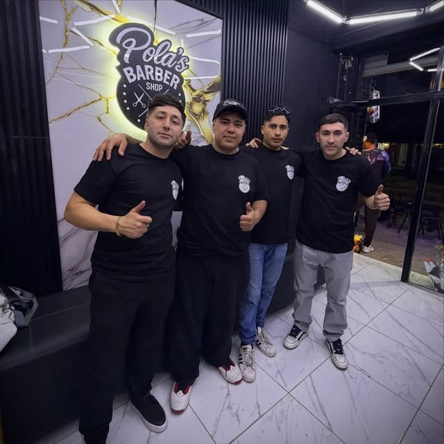
  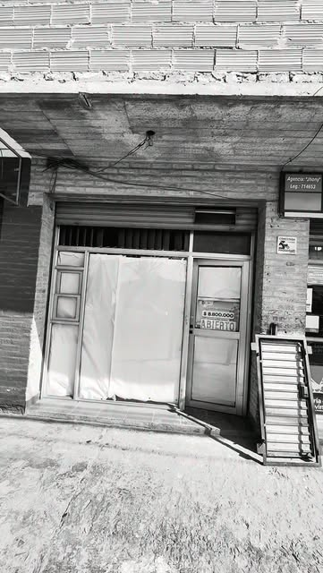

*El equipo en el local nuevo (izquierda) y el mismo local antes de las refacciones (derecha).*

La distribución propuesta del local está en el [punto 10.14](#1014-maquetado-físico--sweet-home-3d).

---

## 10.3 Triangulación de medios de transporte y ubicación

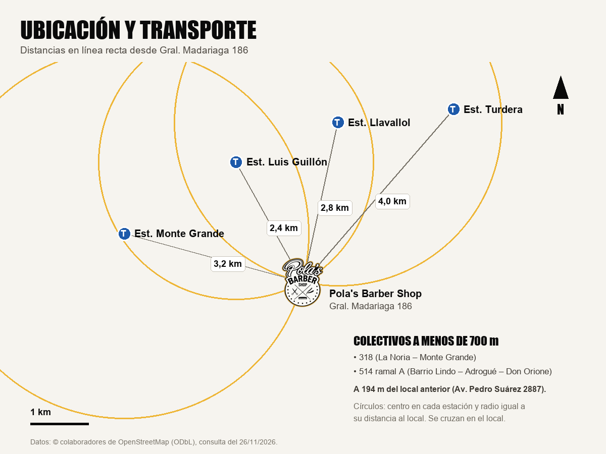

**Método.** Se ubicó el local a partir de su distancia a tres puntos conocidos: las estaciones de tren más cercanas. Cada círculo tiene centro en una estación y radio igual a su distancia al local, y los tres se cortan en un único punto, que es la barbería. Los datos se obtuvieron de **OpenStreetMap** (consulta del 26/11/2026) y las distancias son en línea recta.

| Referencia | Medio | Distancia | Dirección desde el local |
|------------|-------|-----------|--------------------------|
| Estación Luis Guillón | Tren Roca (Trenes Argentinos) | 2,4 km | Noroeste |
| Estación Llavallol | Tren Roca | 2,8 km | Norte |
| Estación Monte Grande | Tren Roca | 3,2 km | Oeste |
| Estación Turdera | Tren Roca | 4,0 km | Noreste |
| Línea 318 (La Noria – Monte Grande) | Colectivo | Recorrido a menos de 700 m | — |
| Línea 514, ramal A (Barrio Lindo – Adrogué – Don Orione) | Colectivo | Recorrido a menos de 700 m | — |
| Av. Pedro Suárez / Cap. de Fragata Moyano (local anterior) | Referencia vial | 194 m | Noroeste |

**Cómo llegar en pocas palabras:** desde las estaciones Luis Guillón o Llavallol, o en las líneas 318 y 514 que pasan por la zona. En auto, la referencia es la Av. Pedro Suárez.

Limitaciones: OpenStreetMap no tiene cargadas las paradas de colectivo de la zona, y puede haber otras líneas que no figuren. Conviene confirmar recorridos y paradas con una aplicación de transporte antes de publicarlos.

---

## 10.4 Isotipo

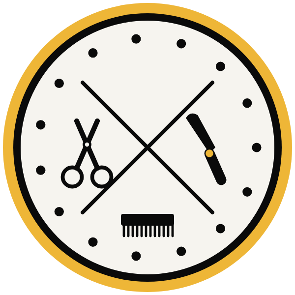

*Propuesta.* El isotipo es el **sello circular del logo sin el texto**: círculo blanco con borde negro y aro mostaza, quince puntos alrededor, la cruz central y las tres herramientas del oficio (tijera, navaja y peine), dibujados igual que en el logo.

- **Para qué:** usos en tamaño chico, donde el logo completo no se lee. Por ejemplo favicon del sitio, foto de perfil reducida, stickers y sellos de la tarjeta de fidelidad.
- **Cuándo no:** nunca reemplaza al logo en la fachada, la papelería ni el packaging.
- **Formato:** vectorial (SVG): se puede ampliar sin perder calidad. Archivo: [marketing/isotipo.svg](../marketing/isotipo.svg).

---

## 10.5 Logotipo

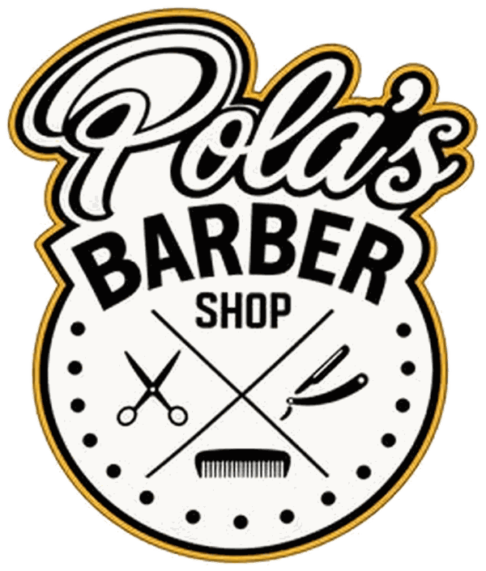

El logo de la barbería es un **isologotipo**: el nombre y el símbolo forman una sola pieza y no se separan. Tiene tres partes:

| Parte | Qué comunica |
|-------|--------------|
| **"Pola's"** en letra manuscrita | El nombre, con personalidad: cercano y con movimiento |
| **"BARBER SHOP"** en imprenta gruesa | El rubro, claro y legible |
| **Sello circular** con puntos, tijera, navaja y peine | El oficio y la tradición de la barbería |

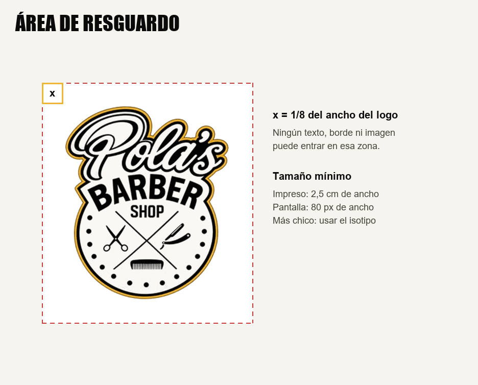

- **Área de resguardo:** un margen libre de **1/8 del ancho del logo** alrededor.
- **Tamaño mínimo:** 2,5 cm de ancho impreso u 80 px en pantalla. Más chico se usa el isotipo.
- **Versiones:** a color sobre fondo claro u oscuro (principal), una tinta negra y una tinta calada en blanco.

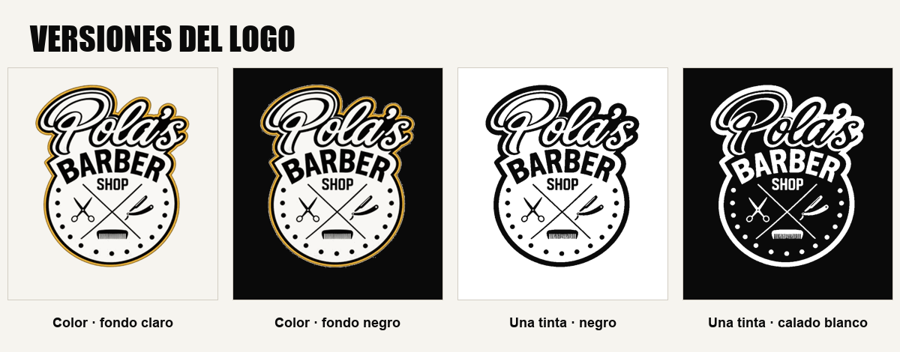

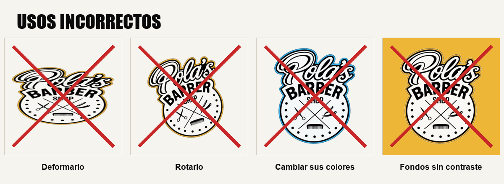

**Recomendación importante:** hoy el logo solo existe como imagen de mapa de bits, recortada de una publicación de Instagram. Para la marquesina, los vinilos y los bordados **conviene vectorizarlo**: redibujarlo en un programa como Illustrator o Inkscape.

---

## 10.6 Círculo cromático y paleta institucional

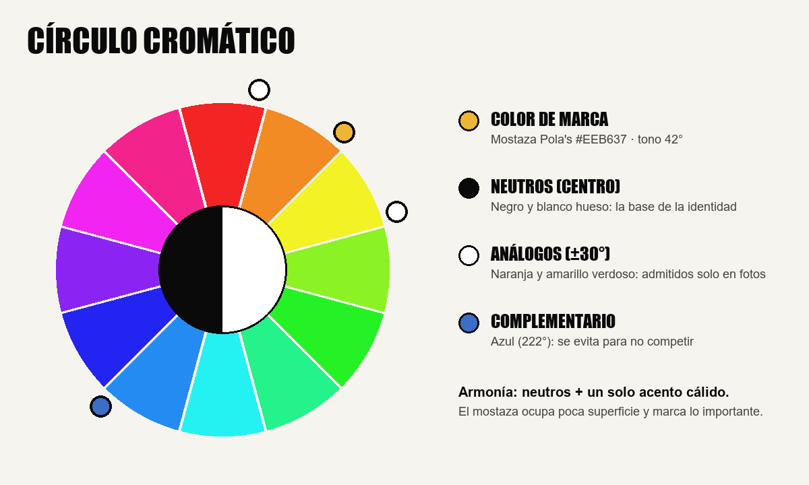

**Armonía:** **neutros (negro y blanco) más un solo acento cálido**, el mostaza. El acento se usa en poca superficie para marcar lo importante: botones, precios y palabras destacadas. El complementario del mostaza (azul) se evita para que no compita.

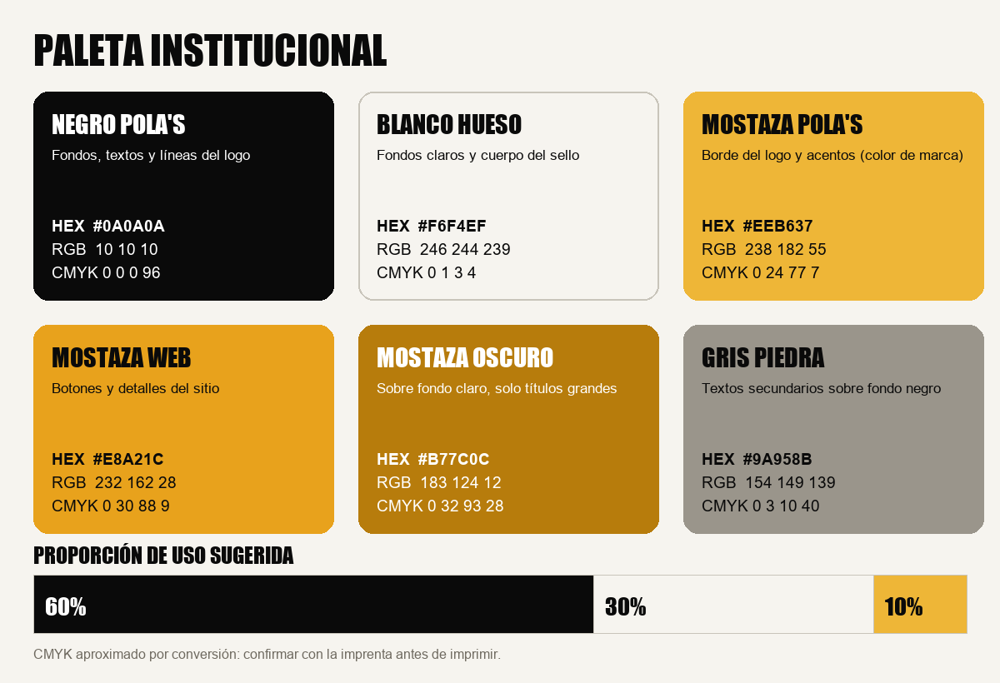

| Color | HEX | Uso |
|-------|-----|-----|
| Negro Pola's | `#0A0A0A` | Fondos, textos y líneas del logo (60 % de la superficie) |
| Blanco hueso | `#F6F4EF` | Fondos claros y cuerpo del sello (30 %) |
| **Mostaza Pola's** | `#EEB637` | Color de marca, medido del borde del logo (10 %) |
| Mostaza web | `#E8A21C` | Botones y detalles del sitio |
| Mostaza oscuro | `#B77C0C` | Sobre fondo claro, solo títulos grandes |
| Gris piedra | `#9A958B` | Textos secundarios sobre fondo negro |

**Contraste para la lectura** (calculado con la norma WCAG 2.1):

| Combinación | Contraste | Resultado |
|-------------|-----------|-----------|
| Blanco hueso sobre negro | 18,0 : 1 | Excelente (AAA) |
| Mostaza Pola's sobre negro | 10,7 : 1 | Excelente (AAA) |
| Negro sobre mostaza web (botones del sitio) | 9,1 : 1 | Excelente (AAA) |
| Gris piedra sobre negro | 6,6 : 1 | Bueno (AA) |
| Mostaza oscuro sobre blanco hueso | 3,2 : 1 | Solo títulos grandes |
| Gris piedra sobre blanco hueso | 2,7 : 1 | No apto para texto |
| Mostaza Pola's sobre blanco hueso | 1,7 : 1 | No apto para texto |

**Conclusión:** el mostaza funciona sobre negro; sobre fondos claros se usa para formas y detalles, nunca para texto. El sitio aplica esta regla: sobre fondos claros sus textos son negros o gris oscuro.

**Tipografías:**
- **Anton** para títulos, en mayúsculas; remite al "BARBER" del logo.
- **Archivo** para textos.
- **Yellowtail** para palabras manuscritas sueltas en mostaza; remite al "Pola's".

Las tres son de Google Fonts, con licencia libre.

---

## 10.7 Productos

**Servicios** (precios de referencia del sitio, *a validar*):

| Servicio | Duración | Precio |
|----------|----------|--------|
| Corte (fade, taper, clásico o tijera) | 30 min | $9.000 |
| Corte + barba | 60 min | $12.000 |
| Barba | 30 min | $5.000 |
| Corte + diseño | 30 min | $10.500 |
| Color / platinado | 120 min | $25.000 |
| Corte niño (hasta 12 años) | 30 min | $7.500 |

**Tienda** (catálogo de ejemplo cargado en el sitio, *a validar*):

| Línea | Productos | Precios |
|-------|-----------|---------|
| Remeras | Pola's Classic (negra) y Pola's White, talles S a XXL | $18.000 |
| Buzos | Oversize Barber y Street Gris | $36.000 a $38.000 |
| Gorras | Trucker Pola's y Gold Edition (edición limitada) | $15.000 a $16.500 |
| Styling | Pomada mate, cera brillo, polvo texturizador | $7.500 a $9.500 |
| Barba | Aceite y shampoo | $8.000 a $9.000 |
| Herramientas | Navaja clásica | $14.000 |

Todos se pueden comprar desde el [módulo de pago del sitio](DOCUMENTACION_TECNICA.md#51-escenarios-principales). Precios y productos se editan en `js/data.js`.

---

## 10.8 Merchandising

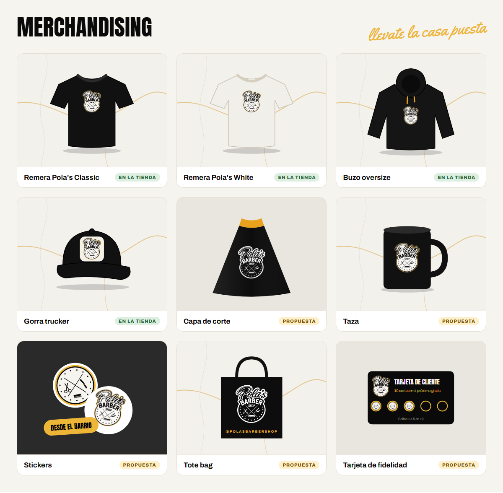

| Pieza | Estado | Para qué sirve |
|-------|--------|----------------|
| Remeras negra y blanca, buzo oversize, gorra trucker | **En la tienda** | Ingreso por ventas y publicidad en la calle |
| Capa de corte con el logo | Propuesta | Imagen profesional en cada foto que suben los clientes |
| Taza | Propuesta | Uso en el local y regalo a clientes frecuentes |
| Stickers (logo, isotipo y "Desde el barrio") | Propuesta | Regalo con cada compra; bajo costo y alta difusión |
| Tote bag | Propuesta | Bolsa para las compras de la tienda |
| **Tarjeta de fidelidad** (10 cortes, el siguiente gratis) | Propuesta | Que el cliente vuelva; usa el isotipo como sello |

---

## 10.9 Diversas aplicaciones del logo

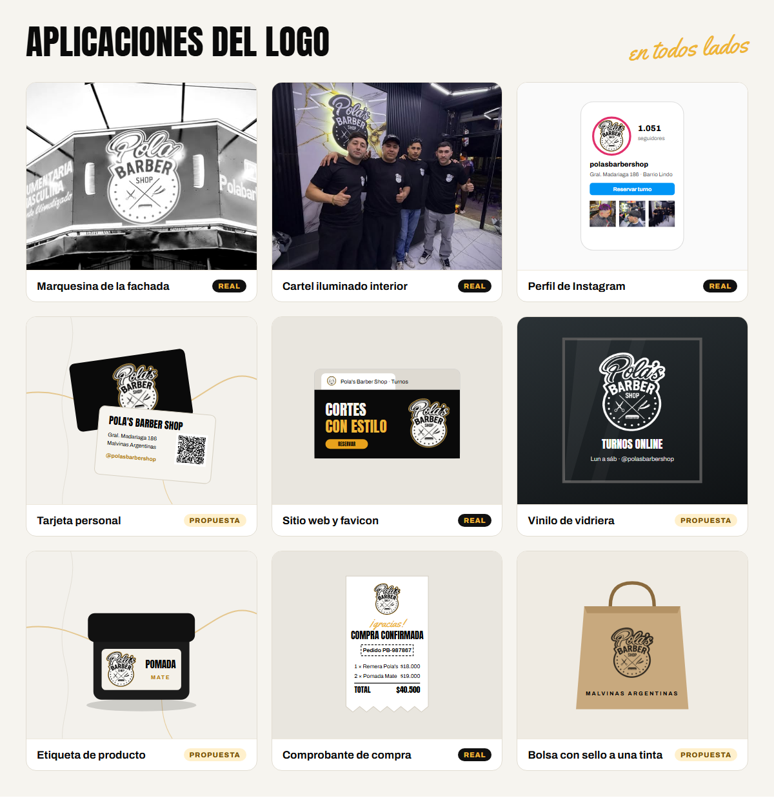

| Aplicación | Estado | Versión del logo |
|------------|--------|------------------|
| Marquesina de la fachada | Real | Color, sobre fondo oscuro |
| Cartel iluminado interior | Real | Color, retroiluminado |
| Perfil de Instagram | Real | Color en círculo |
| Sitio web, favicon y comprobante de compra | Real (este proyecto) | Color e isotipo |
| Tarjeta personal | Propuesta | Color al frente y QR "Cómo llegar" al dorso |
| Vinilo de vidriera | Propuesta | Una tinta calada en blanco |
| Etiqueta de producto (pomadas, ceras) | Propuesta | Color sobre etiqueta clara |
| Bolsa de papel | Propuesta | Una tinta negra (sello) |

---

## 10.10 Estudio de identidad visual

**Concepto:** *barbería clásica con alma de barrio*. El sello circular y las herramientas remiten a la barbería tradicional; la letra manuscrita y el mostaza le dan calidez y personalidad; el negro aporta la estética urbana actual.

**Coherencia entre canales:**

| Canal | Qué se repite | Observación |
|-------|---------------|-------------|
| Local físico | Logo iluminado, mármol con vetas doradas, listones negros | Muy coherente con el logo: el dorado del mármol dialoga con el mostaza |
| Instagram | Logo de perfil, fotos del local en blanco y negro, cortes a color | Buena identidad, pero el enlace de la biografía sigue llevando al local anterior |
| Sitio web (este proyecto) | Paleta, tipografías, texturas de mármol y listones, fotos en blanco y negro | Traslada al sitio lo que ya existía en el local |

**Fortalezas:**
- El logo es reconocible y tiene un estilo bien definido.
- La paleta es reducida y distintiva: negro, blanco y mostaza.
- El local nuevo refuerza la marca con materiales en sus colores.

**Debilidades encontradas:**
- El logo **solo existe en baja resolución**, sin versión vectorial.
- En tamaños chicos "SHOP" y las herramientas se pierden, y no había una versión reducida. Se propone el isotipo (10.4).
- No había reglas escritas de uso: colores, tipografías, márgenes. Se resuelve con el manual (10.11).
- El enlace de Google Maps de Instagram lleva a la dirección vieja.

**Recomendaciones:**
1. Vectorizar el logo.
2. Adoptar el manual de identidad.
3. Actualizar la biografía de Instagram.
4. Producir las piezas de bajo costo y alto impacto: stickers, tarjeta de fidelidad y vinilo de vidriera.

---

## 10.11 Manual de identidad / manual de usuario

**Manual de identidad** — [marketing/manual-identidad.pdf](../marketing/manual-identidad.pdf) (8 páginas A4):

| Página | Contenido |
|--------|-----------|
| 1 | Portada |
| 2 | La marca: concepto, valores y tono de voz con ejemplos |
| 3 | Logotipo: partes, área de resguardo, tamaño mínimo y recomendación de vectorizar |
| 4 | Versiones del logo e isotipo |
| 5 | Color: paleta y círculo cromático |
| 6 | Tipografía: Anton, Archivo y Yellowtail, con su jerarquía |
| 7 | Usos incorrectos, texturas y fotografía |
| 8 | Aplicaciones |

**Manual de usuario del sitio** — [MANUAL_USUARIO.md](MANUAL_USUARIO.md): cómo reservar, cancelar y comprar (clientes), cómo usar el panel (barbería) y cómo cambiar precios, horarios y productos (quien mantiene el sitio).

---

## 10.12 Tríptico informativo

Archivo para imprimir: [marketing/triptico.pdf](../marketing/triptico.pdf), A4 apaisado, dos caras.

**Cara exterior** (de izquierda a derecha: solapa interior, contratapa, tapa):

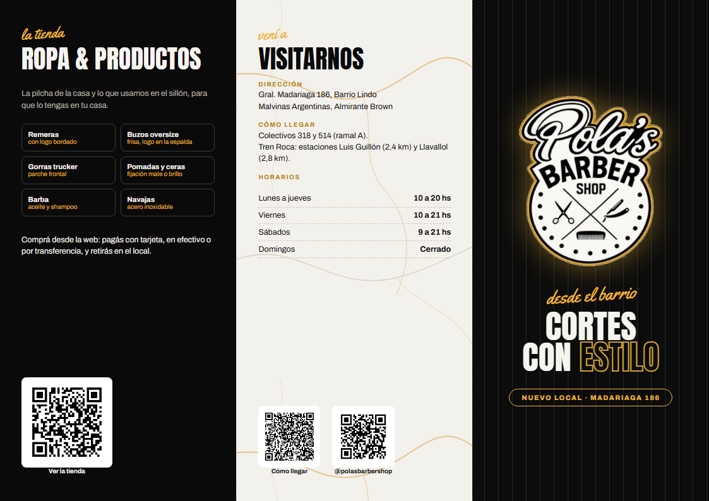

**Cara interior** (historia, servicios, turnos):

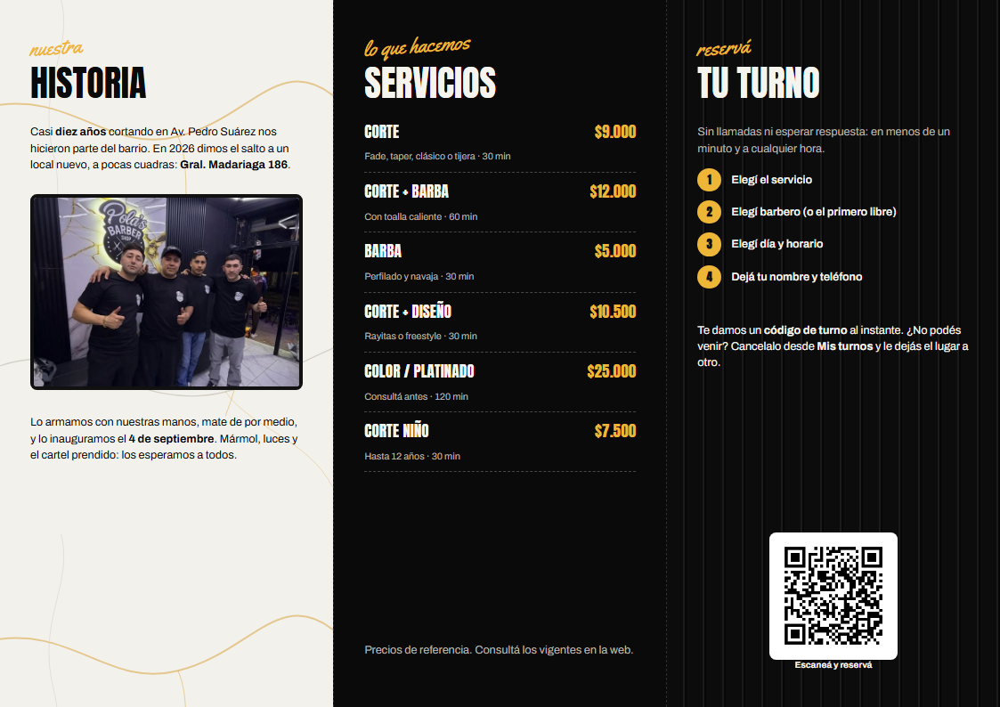

| Panel | Contenido |
|-------|-----------|
| Tapa | Logo, "desde el barrio", "Cortes con estilo", "Nuevo local · Madariaga 186" |
| Contratapa | Dirección, cómo llegar (colectivos y tren), horarios, QR de "Cómo llegar" e Instagram |
| Solapa | La tienda: ropa y productos, con QR a la tienda |
| Interior 1 | Historia: casi 10 años, la mudanza y la reinauguración, con foto del equipo |
| Interior 2 | Servicios con duración y precio |
| Interior 3 | Turnos online en 4 pasos, con QR para reservar |

**Impresión:** doble faz, girando por el **borde corto**, en papel ilustración de 150 g o más. Se pliega en tres, tipo carta, con la tapa hacia afuera.

---

## 10.13 Códigos QR de los sectores

Cada sector del local tiene un QR que lleva a la parte del sitio que le sirve al cliente en ese lugar. Así se conecta el local físico con el sitio web.

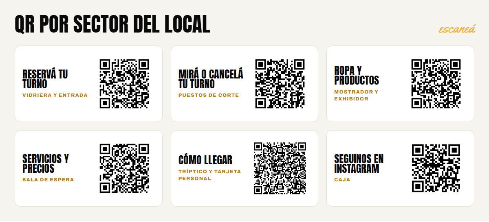

| QR | Destino | Sector del local | Para qué |
|----|---------|------------------|----------|
| Reservá tu turno | Sitio, sección Turnos | Vidriera y entrada | Reservar aunque el local esté cerrado |
| Mirá o cancelá tu turno | Sitio, Mis turnos | Puestos de corte (espejos) | Reservar el próximo turno antes de irse |
| Ropa y productos | Sitio, Tienda | Mostrador y exhibidor | Comprar lo que ven en el local |
| Servicios y precios | Sitio, Servicios | Sala de espera | Ver qué se puede hacer mientras espera |
| Cómo llegar | Google Maps | Tríptico y tarjeta personal | Abrir el mapa en el celular |
| Seguinos en Instagram | Instagram | Caja | Sumar seguidores |

**Para imprimir:** [marketing/carteles-qr.pdf](../marketing/carteles-qr.pdf) trae 6 carteles A5, dos por hoja A4. Los QR sueltos están en [marketing/qr/](../marketing/qr/).

> **Importante:** los cuatro QR del sitio apuntan a `https://leandropereyra-arg.github.io/PolaBarberShop/`, la dirección que tendrá cuando se publique en GitHub Pages ([sección 8.3](DOCUMENTACION_TECNICA.md#83-publicación-del-sistema)). **Hasta que se publique, esos QR llevan a una página de error.** Los de Google Maps e Instagram funcionan desde ya. Probalos con el celular antes de imprimir. Si el sitio se publica en otra dirección, se cambia la variable `SITIO` en `marketing/generar.py` y se vuelven a generar.

---

## 10.14 Maquetado físico — Sweet Home 3D

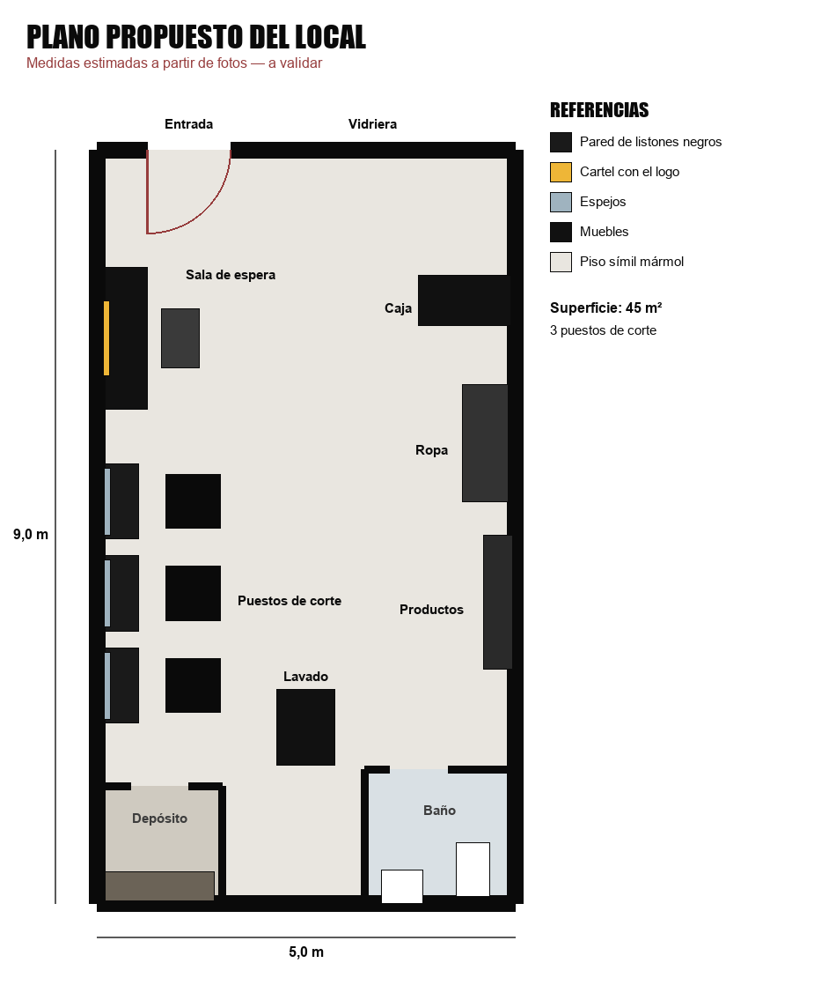

**Archivo:** [marketing/sweet-home/local-polas.sh3d](../marketing/sweet-home/local-polas.sh3d), para abrir con [Sweet Home 3D](https://www.sweethome3d.com/es/), un programa gratuito.

**Qué incluye:**
- El local de **5 × 9 m (45 m²)** con sus paredes, la puerta de entrada y la vidriera.
- **Ambientes:** salón, baño y depósito, con colores de piso.
- **Pared de listones negros** del lado de los puestos de corte.
- **Sala de espera:** banco, mesa ratona y el cartel iluminado con el logo.
- **3 puestos de corte:** espejo, mesada y sillón de barbero cada uno.
- **Mostrador y caja**, exhibidor de ropa, estantería de productos y lavacabezas.
- Cotas de ancho y fondo, y etiquetas de cada zona.

**Limitaciones, para tener en cuenta:**

1. **Las medidas son estimadas** a partir de las fotos de Instagram; la distribución es una propuesta. Para que sea fiel hay que medir el local.
2. **Los muebles son bloques simples** con el nombre y el color de cada uno. Para que se vean realistas, en Sweet Home 3D se reemplaza cada bloque por un mueble del catálogo: se lo selecciona, se lo borra y se arrastra el del catálogo a la misma posición.
3. **El archivo no se pudo probar**, porque Sweet Home 3D no está instalado en la computadora donde se generó. Si no abre, la alternativa es importar el plano como fondo (*Plano → Importar imagen de fondo*, usando `docs/identidad/plano-local.png`, con escala de 5 m de ancho) y dibujar las paredes encima.

**Para obtener las vistas 3D:** con el archivo abierto, la vista 3D aparece abajo. Para guardar una imagen se usa *Vista 3D → Crear foto*, y *Vista 3D → Visita virtual* permite recorrer el local.

---

## 10.16 Integración del sector

> La guía de la cátedra no tiene un punto 10.15.

El sector de marketing no está aparte del sistema: comparte la identidad y los datos con el sitio, y cada pieza física lleva a una función del sitio.

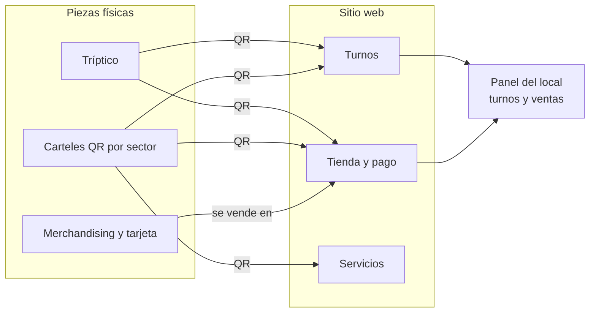

| Integración | Cómo se da |
|-------------|------------|
| **Una sola identidad** | El sitio y las piezas impresas usan los mismos colores, tipografías y texturas. `marketing/marca.css` replica las variables de `css/styles.css` |
| **Del local a la web** | Los QR de cada sector y del tríptico llevan a turnos, tienda y servicios |
| **Merchandising a la venta** | Remeras, buzos y gorras se venden en la tienda del sitio, con su módulo de pago |
| **Mismos datos** | Servicios, precios, horarios y productos del tríptico salen de `js/data.js`; si cambian, se actualizan en los dos lados |
| **Medición** | El panel muestra turnos y ventas por día; con eso se puede ver si una campaña (por ejemplo, repartir trípticos) generó más reservas |
| **Mantenimiento** | `python marketing/generar.py` vuelve a generar paleta, logos, QR, plano, archivo de Sweet Home 3D y los PDF |
